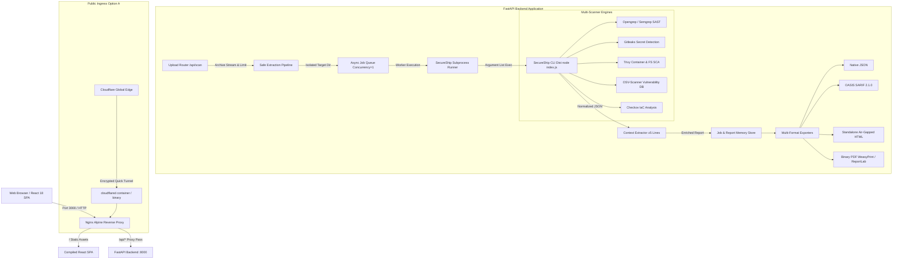
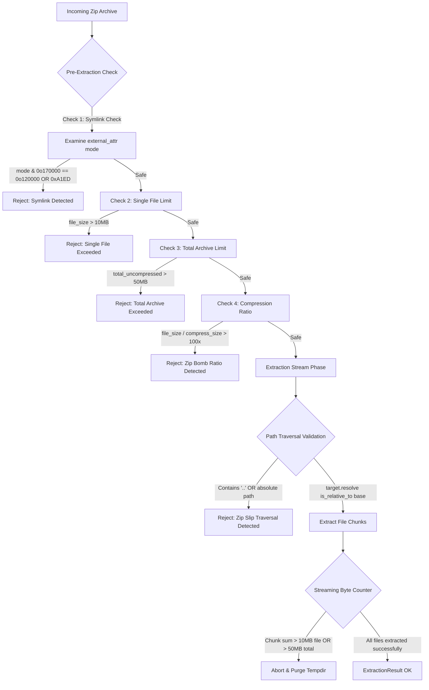
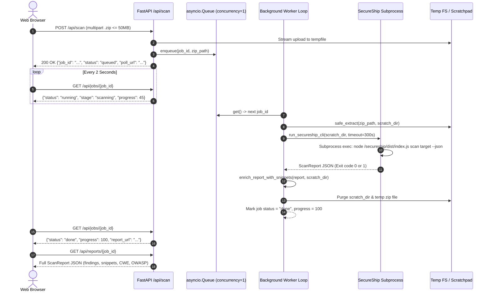

# SecureScan System Architecture & Engineering Specification

## 1. Executive Summary

**SecureScan** is a defensive, containerized security scanning web platform built for the **Heyram Infrastructure** placement assessment. It provides an intuitive, high-performance web interface that wraps the **SecureShip** multi-engine security intelligence platform. SecureScan accepts source code archives (`.zip`), subjects them to five layers of defensive archive extraction validation, executes an asynchronous scanning pipeline powered by pre-baked security engines (SAST, SCA, Secret Detection, and IaC), unifies disparate finding schemas into standardized taxonomies (MITRE CWE and OWASP Top 10:2021), extracts contextual source code snippets (&plusmn;5 lines), and provides interactive data visualizations alongside multi-format export capabilities (JSON, OASIS SARIF 2.1.0, standalone HTML, and binary PDF).

---

## 2. Safe Extraction Pipeline: Defense in Depth

Archive decompression represents one of the most hazardous operations in software security. To guarantee that malicious or malformed archives cannot compromise the host environment, `safe_extract()` enforces five strict defensive invariants before and during extraction:

### Invariant Breakdown:
1. **Zip-Slip Path Traversal Defense:** Every archive member's path is checked before disk access. Filenames containing `..`, absolute POSIX paths (`/etc/passwd`), or Windows drive letters (`C:\Windows`) are rejected immediately. Furthermore, post-resolution canonical checks guarantee `Path(target_dir / member).resolve().is_relative_to(target_dir)`.
2. **Symlink Defense (`0xA1ED` & `S_IFLNK`):** POSIX symbolic links inside zip files frequently serve as vectors for arbitrary file disclosure (linking to `/etc/shadow` or sensitive keys). Members whose external attributes have `mode & 0o170000 == 0o120000` or explicit attribute `0xA1ED` are rejected with `ValueError`.
3. **Zip-Bomb Decompression Ratio Guard:** Recursive or highly compressed archives designed to exhaust server disk/memory are rejected if `uncompressed_size / compressed_size > 100.0`.
4. **Strict Size Quotas:**
   - Single uncompressed file ceiling: **10 MB** (10,485,760 bytes).
   - Total extracted archive ceiling: **50 MB** (52,428,800 bytes).
   - Enforced both in header metadata pre-checks and during real-time streaming chunk counters to thwart deceptive header spoofing.
5. **Deterministic Lifecycle Cleanup:** Extraction occurs inside an isolated temporary directory created via `tempfile.mkdtemp(prefix="securescan_job_")`. A strict `finally` block guarantees recursive deletion via `shutil.rmtree()` upon scan completion or error, with read-only permission unmasking for Windows/POSIX safety.

---

## 3. Asynchronous Single-Worker Job Queue

To protect host CPU and memory ceilings (3.0 GB RAM / 1.5 CPUs) against denial-of-service or memory thrashing, SecureScan implements an `asyncio.Queue` architecture constrained to concurrency = 1:

---

## 4. Scanner Execution Runner Contract

The execution harness (`backend/app/core/runner.py`) satisfies four strict operational guarantees:
1. **Argument List Invocation (No `shell=True`):** Commands are passed directly as structured lists:
   `[node_bin, cli_dist_path, "scan", str(target), "--json"]`
   eliminating any possibility of command injection or shell metacharacter manipulation.
2. **Hard 300-Second Timeout:** Monitored via `asyncio.wait_for(process.communicate(), timeout=300.0)`. If exceeded, child processes are terminated with `SIGKILL` and a `ScannerTimeoutError` is raised.
3. **Dual Success Exit Code Semantics:**
   - **Exit Code 0:** Clean scan (no findings detected). Output parsed as valid report JSON.
   - **Exit Code 1:** Findings detected. Output parsed as valid report JSON.
   - **Exit Code &ge; 2:** Fatal runner/scanner error. Raises `ScannerExecutionError`.
4. **Working Directory & Tree-sitter Resolution:** The process `cwd` is locked to `/secureship` (or repository root), ensuring Tree-sitter WASM grammars and relative configuration schemas resolve reliably without depending on the untrusted target directory.

---

## 5. Unified Finding Model & Taxonomical Enrichment

Disparate security scanners produce inconsistent output formats. SecureScan normalizes all raw outputs into a unified Pydantic v2 `ScanReport` schema:

| Engine | Primary Domain | Output Mapping |
|--------|----------------|----------------|
| **Opengrep / Semgrep** | SAST (Static Application Security Testing) | Source line ranges, AST pattern IDs, CWE tags |
| **Gitleaks** | Secret Detection | High-entropy strings, API keys, private credentials |
| **Trivy** | Filesystem SCA & OS packages | CVE IDs, CVSS scores, vulnerable package versions |
| **OSV-Scanner** | Open Source Vulnerability Database | Dependency lockfile vulnerabilities |
| **Checkov** | IaC (Infrastructure as Code) | Dockerfile, Terraform, Kubernetes misconfigurations |

### CWE to OWASP Top 10 (2021) Mapping Engine
Findings are categorized using an authoritative three-tier classifier:
1. **Tier 1 (Authoritative CWE Map):** Direct mapping of numeric CWE IDs to OWASP Top 10:2021 categories (e.g., CWE-89 -> `A03:2021-Injection`, CWE-798 -> `A07:2021-Identification and Authentication Failures`, CWE-22 -> `A01:2021-Broken Access Control`).
2. **Tier 2 (Rule & Keyword Heuristics):** Regular expression matching on rule IDs and titles for specialized categories (e.g., SSRF, deserialization, cryptographical failures).
3. **Tier 3 (Domain Fallback):** Categorical fallback based on finding category (e.g., `SECRET` -> A07, `SCA` -> A06, `IAC` -> A05).

---

## 6. Code Context Extractor

`backend/app/core/context_extractor.py` provides high-fidelity source code context for each finding:
- **Context Window:** Extracts &plusmn;5 lines surrounding `[start_line, end_line]`.
- **Target Tagging:** Slices are parsed into structured `SnippetLine` items, marking `is_target = True` for the exact reported line.
- **Defensive Invariants:**
  - Path traversal checks prevent reading files outside the target directory.
  - Multi-encoding fallback tries `UTF-8` followed by `Latin-1`.
  - Binary file rejection halts extraction if null bytes (`\x00`) occur in the first 4,096 bytes.
  - Boundary clamping prevents negative index lookups or indexing past the end of the file.

---

## 7. Multi-Format Exporters

SecureScan provides four export formats via `/api/reports/{id}/export?format={json|sarif|html|pdf}`:

1. **Native JSON:** Strongly-typed representation with dual camelCase/snake_case interoperability.
2. **OASIS SARIF 2.1.0:** Fully compliant with the OASIS Standard for Static Analysis Results Interchange Format. Includes tool driver definitions, rule property tags (CWE and OWASP), and physical location uri references compatible with GitHub Code Scanning.
3. **Air-Gapped Single-File HTML:** Self-contained HTML report with embedded CSS styling (`<style>`), zero external CDN requests, executive metric cards, scanner badges, and formatted code blocks.
4. **Binary PDF (ReportLab):** Executive PDF document with `%PDF-` header, summary tables, severity color indicators, OWASP breakdown, and wrapped code context blocks.

---

## 8. Containerization & Resource Governance

The production deployment uses Docker Compose with strict cgroup constraints:
- **CPU Limit:** 1.5 cores (prevents scanner thread storms from starving the host).
- **Memory Limit:** 3,072 MB / 3 GB (prevents out-of-memory kernel panics during AST parsing).
- **Non-Root Execution:** Backend runs under user `securescan` (UID 10001) with root-owned immutable tool directories (`chmod 0555`).
- **Healthchecks:** Native HTTP probes verify backend readiness on `/api/health` before frontend traffic routing.
