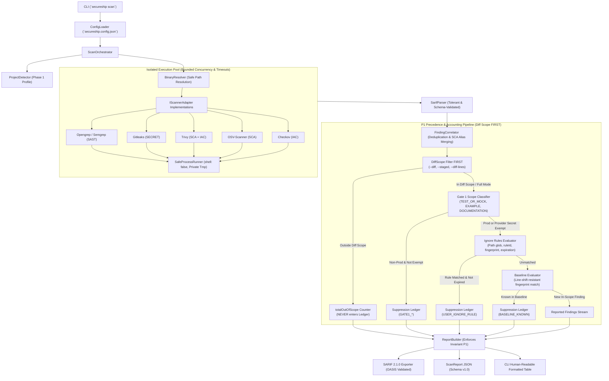

# SecureShip Phase 2: Architecture & Data Flow Specification

## 1. System Overview

SecureShip Phase 2 ("SCAN PIPELINE") implements a production-grade, local-first security scanning orchestrator. It executes multi-engine security scanners (`opengrep`/`semgrep`, `gitleaks`, `trivy`, `osv-scanner`, `checkov`) in isolated child processes, normalizes diverse findings into a unified data model, enforces scope tagging (Gate 1), maintains an auditable suppression ledger with a strict mathematical invariant, supports incremental scans via Git diff scoping, and produces compliant SARIF 2.1.0 output.

---

## 2. End-to-End Pipeline Architecture

---

## 3. Product Invariants & Guarantees

### Principle P1: The Invariant P1 Ledger Guarantee

$$\text{totalRaw} = \text{totalReported} + \text{totalSuppressed} + \text{totalOutOfScope}$$

Every finding emitted by any scanner adapter is accounted for with cryptographic fingerprinting. Findings are categorized into **exactly one** mutually exclusive bucket:

1. **`totalOutOfScope`**: Incremental diff scoping is evaluated **FIRST**. If `--diff`, `--staged`, or `--diff-lines` is active, any finding located outside the modified files or modified hunk ranges is immediately routed to `totalOutOfScope`. Such findings **never enter the suppression ledger** and do not undergo Gate 1 or ignore evaluation.
2. **`totalSuppressed`**: In-scope findings that match Gate 1 non-production patterns, an active user ignore rule, or an existing baseline entry are added to the `SuppressionLedger` with an explicit `SuppressionReasonCode`.
3. **`totalReported`**: In-scope findings that are not suppressed and are not out of scope. These represent actionable security issues.

### Precedence Order

$$\text{Diff Scoping} \longrightarrow \text{Gate 1 Scope Tagging} \longrightarrow \text{Ignore Rules} \longrightarrow \text{Baseline Matching}$$

When a finding is out-of-scope, it is never evaluated against Gate 1, ignore rules, or baseline. When a finding is in-scope:

1. Gate 1 takes precedence (if non-production, marked `GATE1_TEST_OR_MOCK`, `GATE1_EXAMPLE`, or `GATE1_DOCUMENTATION`).
2. If Gate 1 does not suppress (or `--include-nonproduction` is set), user ignore rules are checked (`USER_IGNORE_RULE`).
3. If no ignore rule applies, baseline matching is checked (`BASELINE_KNOWN`).
4. If none apply, the finding is reported.

---

## 4. Gate 1 Scope Classification & Secret Policy

Gate 1 classifies file paths into four contextual scopes:

- `PRODUCTION` (code deployed to production)
- `TEST_OR_MOCK` (unit/integration tests, test harnesses, mock fixtures)
- `EXAMPLE` (sample code, tutorials, demo scripts)
- `DOCUMENTATION` (markdown files, docstrings, technical documentation)

### Secret Policy in Non-Production Scope

By default (`gate1.keepProviderSecrets = true`), high-entropy provider-specific secrets (e.g. AWS access keys, GitHub tokens, Slack tokens, Stripe keys, Private Key headers) located in test or fixture files are **NOT suppressed** unless their value matches a known placeholder string:

- Placeholder values: `EXAMPLE`, `dummy`, `changeme`, `xxxx`, `test`, `sample`, `placeholder`, `fake`, `00000000`, `12345678`.
- If an actual active provider credential pattern is detected in test code, it remains reported with `confidence: MEDIUM` so real leaked credentials in tests are not silently ignored.
- Non-secret findings (SAST, SCA, IAC) in test code are suppressed under Gate 1 reason codes.
- The `--include-nonproduction` CLI flag forces Gate 1 suppression to be skipped entirely.

---

## 5. Git Safety & Incremental Diff Scoping

Incremental scanning (`--diff <ref>`, `--staged`, `--diff-lines`) relies on `SafeProcessRunner` invoking `git` directly (`shell: false`):

1. **Ref Validation**: Target git revisions are strictly validated against option injection. Any ref beginning with `-` (such as `--upload-pack`) or containing shell metacharacters (`;&|`) is rejected immediately with exit code 2.
2. **Boundary Disambiguation**: Refs are passed after `--end-of-options` and `--` to guarantee git interprets them as revision specifiers and not options.
3. **NUL-Delimited Parsing**: `git diff -z` and `git status -z` are used to prevent whitespace or Unicode file path corruption.
4. **Hunk Range Mapping**: Modified hunk headers `@@ -l,s +start,count @@` are parsed into exact line intervals `[start, start + count - 1]`.
5. **Secret Scope Rule**: Under `--diff`, findings in the `SECRET` category check whole-file presence in the modified set rather than line ranges, ensuring credentials introduced near existing code are not missed.

---

## 6. Process Isolation & Sandbox Security

All scanner processes are executed under strict sandboxing:

1. **Isolated Temp Directories**: Each scanner execution generates an ephemeral directory (`mkdtemp` with `0700` POSIX permissions) for intermediate outputs, cleaned up in `finally` blocks.
2. **No Shell Execution**: `spawn(executable, args, { shell: false })` prevents command injection.
3. **Target Boundary Guard**: `BinaryResolver` verifies that any scanner binary found on PATH or via config overrides is **outside the scanned target directory**, defeating planted-binary / PATH-hijack attacks.
4. **Clean Environment**: Only whitelisted OS variables (`PATH`, `PATHEXT`, `SYSTEMROOT`, `TEMP`, `LANG`, etc.) are passed. Sensitive tokens (`SUPER_SECRET_TOKEN`, cloud credentials) are stripped before subprocess launch.
5. **Double Secret Redaction**: Subprocess outputs and SARIF snippets are scrubbed through `SecretRedactor` before reaching memory storage, logging, or SARIF output.
6. **Process Tree Termination**: In case of timeouts or SIGINT, descendant trees are killed cleanly using `taskkill /PID <pid> /T /F` on Windows and `process.kill(-pid, 'SIGKILL')` on POSIX.

---

## 7. Exit Codes Specification

| Exit Code | Meaning                 | Triggers                                                                                                                                                                    |
| :-------: | :---------------------- | :-------------------------------------------------------------------------------------------------------------------------------------------------------------------------- |
|   **0**   | Clean Scan              | Scan completed successfully; no findings meet or exceed `--fail-on` threshold.                                                                                              |
|   **1**   | Threshold Exceeded      | One or more reported findings have severity $\ge$ configured `--fail-on` (default: `HIGH`).                                                                                 |
|   **2**   | Usage / Config Error    | Invalid CLI arguments, invalid `secureship.config.json` schema, invalid git ref (e.g. leading `-`), or mutually exclusive options (e.g. `--update-baseline` with `--diff`). |
|   **3**   | Infrastructure Error    | `--strict` mode enabled and any scanner is missing (`TOOL_MISSING`) or failed; or all executed scanners crashed (`ERROR`/`TIMEOUT`).                                        |
|  **130**  | Cancelled / Interrupted | Process received SIGINT (Ctrl+C). Subprocess tree terminated and temp files cleaned up.                                                                                     |
