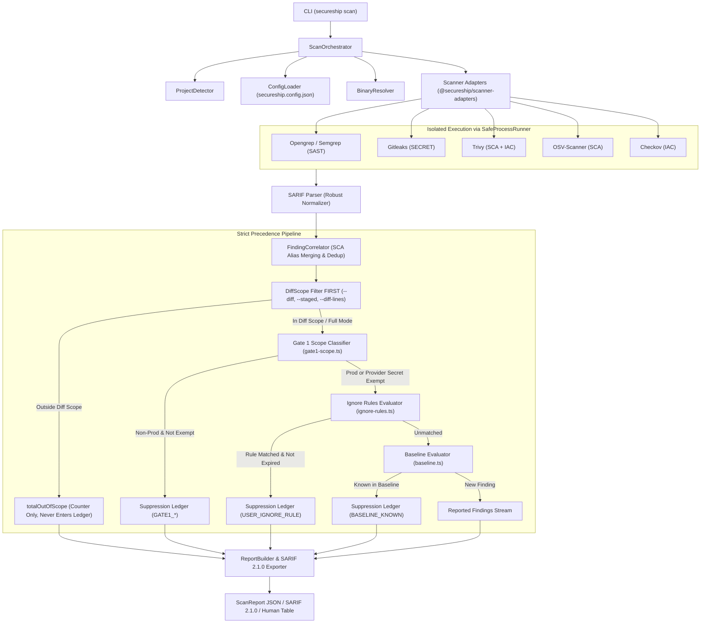

# SecureShip Phase 2: Scan Pipeline — Implementation Plan

## Goal

Implement **SecureShip Phase 2 ("SCAN PIPELINE")** to production standard:

1. Make scanners real with isolated subprocess execution (`SafeProcessRunner`).
2. Normalize all scanner output into a unified `NormalizedFinding` model via a robust, schema-validated SARIF parser.
3. Apply Gate 1 context-aware scope classification (`TEST_OR_MOCK`, `EXAMPLE`, `DOCUMENTATION`) with deterministic provider-secret preservation.
4. Maintain an auditable, strictly invariant suppression ledger (`totalRaw = totalReported + totalSuppressed + totalOutOfScope`).
5. Support incremental scans (`--diff <ref>`, `--staged`, `--diff-lines`) with boundary-safe git parsing and ref injection protection.
6. Export standardized SARIF 2.1.0 with suppression justifications.
7. Implement precision, recall, and suppression-recall benchmarking with a reproducible replay corpus.
8. Deliver strict CLI commands (`scan`, updated `doctor`), full test suites, coverage enforcement (>=85% lines, >=75% branches), linting, and formatting.

---

## Approved Amendments & Design Specifications

> [!IMPORTANT]
>
> ### 1. P1 Precedence & Accounting Invariant
>
> Every raw finding lands in **EXACTLY ONE** mutually exclusive bucket:
>
> - **Step 1 (Diff Scoping — Evaluated FIRST):** If incremental scan (`--diff`, `--staged`, `--diff-lines`) is active, findings located outside the diff are counted immediately in `totalOutOfScope`. They **never enter the suppression ledger**, receive no suppression reason codes, and are not evaluated against Gate 1, ignore rules, or baseline.
> - **Step 2 (Gate 1 Scope):** In-scope findings located in non-production paths (`TEST_OR_MOCK`, `EXAMPLE`, `DOCUMENTATION`) are routed to the suppression ledger with `GATE1_*` reason codes, unless exempted by the Gate 1 Secret Policy.
> - **Step 3 (Ignore Rules):** In-scope findings matching active, unexpired ignore rules in `secureship.config.json` are routed to the ledger with `USER_IGNORE_RULE`.
> - **Step 4 (Baseline):** In-scope findings present in `.secureship/baseline.json` are routed to the ledger with `BASELINE_KNOWN`.
> - **Step 5 (Reported):** All remaining findings are reported as active security findings.
>
> **Mathematical Invariant:** $\text{totalRaw} = \text{totalReported} + \text{totalSuppressed} + \text{totalOutOfScope}$.  
> _Verification Requirement:_ Includes a dedicated test verifying that a finding that is both suppressible (located in test code or matching an ignore rule) and out-of-scope lands in `totalOutOfScope` and never enters the suppression ledger.

> [!IMPORTANT]
>
> ### 2. Baseline & Diff Incompatibility
>
> Combining `--update-baseline` with `--diff` or `--staged` is rejected with **exit code 2** and the clear error message:  
> `"Cannot update baseline in incremental diff or staged mode (--update-baseline combined with --diff or --staged). Baselines must represent the complete repository state."`

> [!IMPORTANT]
>
> ### 3. Schema Discipline: No Redundant `cwe` Field
>
> Do not introduce a redundant `cwe` field on `NormalizedFinding`. Reuse the existing `cweIds: string[]` field (e.g. `["CWE-798"]`).

> [!IMPORTANT]
>
> ### 4. CLI Color Control: `--no-color`
>
> The `scan` command supports `--no-color` to disable all ANSI escape formatting in human-readable terminal output.

> [!IMPORTANT]
>
> ### 5. Output Determinism: No `suppressedAt`
>
> `SuppressedFinding` strictly contains `{ finding, reasonCode, detail, source }` with NO timestamps (`suppressedAt` omitted) to ensure 100% deterministic output across repeated runs.

> [!IMPORTANT]
>
> ### 6. Modular Architecture & Gate 1 Secret Policy
>
> Separate logic into focused, independently unit-tested modules:
>
> - `packages/core-engine/src/gates/gate1-scope.ts`: Context classification and Secret Policy.
> - `packages/core-engine/src/suppression/ledger.ts`: P1 invariant ledger accounting.
> - `packages/core-engine/src/suppression/ignore-rules.ts`: Expiration and rule evaluation.
> - `packages/core-engine/src/suppression/baseline.ts`: Baseline fingerprint matching and updates.
> - `packages/core-engine/src/config/load-config.ts`: Schema validation and config loading.
>
> **Gate 1 Secret Policy:**
>
> - By default (`gate1.keepProviderSecrets = true`), findings with `category: "SECRET"` from provider-specific rules (AWS, GitHub, Slack, Stripe, Private Keys, etc.) whose matched snippet/sink does NOT contain a known placeholder stay reported at `confidence: MEDIUM` (with `scopeTag: "TEST_OR_MOCK"` or other non-production tag retained).
> - **Placeholder list (case-insensitive substring check):** `EXAMPLE`, `dummy`, `changeme`, `change_me`, `xxxx`, `test`, `mock`, `fake`, `sample`, `000000`, `123456`, `placeholder`, `secret_token_here`. Findings matching placeholders are suppressed under `GATE1_TEST_OR_MOCK`.
> - When `--include-nonproduction` is specified, all non-production findings remain reported regardless of category.

> [!IMPORTANT]
>
> ### 7. Git Safety & Option Injection Prevention
>
> - User-provided refs (`--diff <ref>`) are strictly validated: refs starting with `-` are rejected immediately to prevent CLI option injection (e.g. `--upload-pack=x`, `-x`).
> - Dangerous characters (`;`, `&`, `|`, `$`, `` ` ``, `<`, `>`, quotes, whitespace, control characters) are rejected.
> - Validated refs are passed to `git` commands after `--end-of-options` and `--`.
> - Output is parsed using `-z` (NUL-delimited records). No shell is ever invoked (`shell: false`).
> - Dedicated tests cover injection attempts including `"--upload-pack=x"` and `"; touch pwned"`.

> [!IMPORTANT]
>
> ### 8. Trivy Offline Hardening
>
> When `--offline` (or `--skip-db-update`) is used, if no vulnerability database cache (`trivy.db`) exists in the cache directory, `TrivyAdapter` returns status `PARTIAL_FAILURE` with an actionable diagnostic message:
>
> ```
> Trivy is operating in offline mode with --skip-db-update, but no cached vulnerability database (trivy.db) was found at the local cache path. Run "trivy image --download-db-only" or disable --offline mode to initialize the local vulnerability database cache.
> ```
>
> Documented in `docs/phase2/SCANNER-NOTES.md`.

> [!IMPORTANT]
>
> ### 9. Tooling & Pinned Dependencies
>
> - All new dev dependencies are pinned to exact versions in `package.json` (`eslint: "9.21.0"`, `typescript-eslint: "8.24.1"`, `ajv: "8.17.1"`, `ajv-formats: "3.0.1"`, `prettier: "3.5.2"`, `@vitest/coverage-v8": "3.2.7"`).
> - Uses ESLint Flat Config (`eslint.config.js`) compatible with `typescript-eslint` v8.

> [!IMPORTANT]
>
> ### 10. SAST Rule Pack & Precision Hardening
>
> - 10 bundled SAST rules under `rules/secureship-sast/` with positive and negative test fixture files per rule under `rules/secureship-sast/fixtures/`.
> - Automated test executes opengrep/semgrep against these fixtures when available.
> - `secureship-py-insecure-hash` is strictly restricted to password, token, signature, auth, session, key, and credential contexts to limit noise.

> [!IMPORTANT]
>
> ### 11. Scanner Re-Detection & Live vs Docs Verification
>
> - Scanner binaries are detected on system PATH.
> - Flags are verified against real `--help` outputs where available.
> - `docs/phase2/SCANNER-NOTES.md` records the live vs docs-verified flag matrix.
> - Live contract test suite (`packages/scanner-adapters/test/live-contract.test.ts`) auto-activates when binaries are installed on PATH.

---

## Architecture Diagram



---

## Proposed Changes per File

### 1. `@secureship/contracts` (Additive Only)

#### `packages/contracts/src/finding.schema.ts`

- Add optional fields:
  - `aliases?: string[]` (CVE, GHSA, OSV IDs)
  - `package?: { ecosystem: string; name: string; version: string; fixedVersion?: string }`
  - `lockfilePath?: string`
- Reuses existing `cweIds: string[]` (no redundant `cwe` field).

#### `packages/contracts/src/sarif-input.schema.ts`

- Tolerant Zod schema for SARIF 2.1.0 consumption: `runs`, `tool.driver.rules`, `results`, `locations`, `regions`, `level`, `properties`, `partialFingerprints`, `originalUriBaseIds`.

#### `packages/contracts/src/suppression.schema.ts`

- `SuppressionReasonCodeSchema`: `'GATE1_TEST_OR_MOCK' | 'GATE1_EXAMPLE' | 'GATE1_DOCUMENTATION' | 'USER_IGNORE_RULE' | 'BASELINE_KNOWN'`.
- `SuppressedFindingSchema`: `{ finding: NormalizedFinding, reasonCode: SuppressionReasonCode, detail: string, source: string }` (deterministic, NO `suppressedAt`).

#### `packages/contracts/src/scan-report.schema.ts`

- `ScanReportSchema` (schemaVersion `"1.0"`): `tool`, `target`, `mode`, `diffBase?`, `startedAt`, `durationMs`, `scanners[]`, `findings[]`, `suppressed[]`, `summary` (`totalRaw`, `totalReported`, `totalSuppressed`, `totalOutOfScope`, `bySeverity`, `byCategory`, `suppressedByReason`), `warnings[]`.

#### `packages/contracts/src/config.schema.ts`

- Strict schema for `secureship.config.json`:
  - `scanners?: Record<string, boolean>`
  - `timeouts?: { default?: number } & Record<string, number>`
  - `failOn?: Severity | 'NONE'`
  - `ignore?: Array<{ ruleId?: string; pathGlob?: string; fingerprint?: string; reason: string; expires: string }>` (reason min 10 chars, expires ISO date max 12 months ahead)
  - `gate1?: { enabled?: boolean; keepProviderSecrets?: boolean; customTestDirs?: string[] }`
  - `extraRulePacks?: string[]`
  - `baselinePath?: string`
  - `binaryOverrides?: Record<string, string>`

#### `packages/contracts/src/index.ts`

- Re-export all schemas and types.

---

### 2. `@secureship/scanner-adapters`

#### `packages/scanner-adapters/package.json` & `tsconfig.json`

- Workspace package with dependencies on `@secureship/contracts` and `@secureship/core-engine`. Zero external runtime dependencies.

#### `packages/scanner-adapters/src/binary-resolver.ts`

- Resolves executables on PATH (`PATHEXT` on Windows).
- Supports `binaryOverrides`.
- Blocks execution if resolved binary resides within the scanned workspace directory.

#### `packages/scanner-adapters/src/supported-versions.json`

- Tested version matrix per scanner.

#### `packages/scanner-adapters/src/sarif/sarif-parser.ts`

- Normalizes SARIF 2.1.0 into `NormalizedFinding[]`.
- Handles multiple runs, missing regions, missing rule metadata, URL-encoded / `file://` URIs, Windows drive letters, `uriBaseId` resolution.
- POSIX-normalizes paths relative to target root. Drops out-of-boundary paths with a warning.
- Severity mapping: prefers `properties["security-severity"]` CVSS or SARIF `level`.
- Snippets truncated to 500 chars and passed through `SecretRedactor`.
- Handles malformed/oversized payloads cleanly returning `PARTIAL_FAILURE`.

#### `packages/scanner-adapters/src/adapters/`

- `opengrep.adapter.ts`: SAST adapter. Falls back to `semgrep` binary if `opengrep` is missing. Uses bundled rule pack by default.
- `gitleaks.adapter.ts`: SECRET adapter. Configures `--redact`, parses SARIF, redacts all output through `SecretRedactor`.
- `trivy.adapter.ts`: SCA + IAC adapter. Disables secret scanning (`--scanners vuln,misconfig`). When offline (`--offline-scan --skip-db-update`), checks if vulnerability DB cache exists; if not, returns `PARTIAL_FAILURE` with clear diagnostic advice.
- `osv-scanner.adapter.ts`: SCA adapter. Handles both v1 (`osv-scanner -r`) and v2 (`osv-scanner scan`) CLI invocations.
- `checkov.adapter.ts`: IAC adapter. Soft-fail mode for Terraform, Dockerfile, Kubernetes.
- All adapters manage private temp directories (`mkdtemp` mode 0700), clean up in `finally`, honor `timeoutMs` and `AbortSignal`, map exit codes accurately, and never throw out of `scan()`.

---

### 3. Bundled Rule Pack

#### `rules/secureship-sast/*.yml`

10 original rules with CWE tags and license headers:

1. `secureship-js-eval`: `eval` / `new Function` with non-literals (CWE-95).
2. `secureship-js-child-process-exec`: `child_process.exec` with string concat (CWE-78).
3. `secureship-js-sql-concat`: Raw SQL query string concatenation (CWE-89).
4. `secureship-js-hardcoded-jwt-secret`: Hardcoded JWT signing secrets (CWE-798).
5. `secureship-js-insecure-random`: `Math.random` used for crypto/tokens (CWE-338).
6. `secureship-py-yaml-load`: PyYAML `load` without SafeLoader (CWE-502).
7. `secureship-py-pickle-load`: `pickle.loads`/`load` on untrusted data (CWE-502).
8. `secureship-py-subprocess-shell`: `subprocess.Popen`/`run` with `shell=True` (CWE-78).
9. `secureship-py-sql-format`: SQL string formatting in queries (CWE-89).
10. `secureship-py-insecure-hash`: Weak hashes (`md5`/`sha1`) restricted to password/token/signature security contexts (CWE-328).

#### `rules/secureship-sast/fixtures/`

- Positive and negative fixture test files for every rule (`*.positive.js`, `*.negative.js`, `*.positive.py`, `*.negative.py`).
- Automated test executing opengrep/semgrep against these fixtures when available.

---

### 4. `@secureship/core-engine` (Modular Architecture)

#### `packages/core-engine/src/git/diff-scope.ts`

- Extracts changed files and diff line ranges using `SafeProcessRunner` (`git diff`, `git status -z`).
- Validates refs (rejects leading `-` and dangerous characters), passes refs safely after `--end-of-options` or `--`.
- Parses modified line numbers from unified diff hunks (`@@ -l,s +l,s @@`).
- Filters findings: non-matching findings are classified as out-of-scope.

#### `packages/core-engine/src/gates/gate1-scope.ts`

- Classifies paths as `TEST_OR_MOCK`, `EXAMPLE`, `DOCUMENTATION`, or `PRODUCTION`.
- Implements Gate 1 Secret Policy: provider-specific secrets without placeholder values remain reported (`confidence: MEDIUM`, non-production scope tag retained).
- Implements placeholder detector.

#### `packages/core-engine/src/suppression/ledger.ts`

- Suppression Ledger maintaining Invariant P1:
  - `totalRaw = totalReported + totalSuppressed + totalOutOfScope`.
  - Immutable record of suppressed findings with reason code and detail.

#### `packages/core-engine/src/suppression/ignore-rules.ts`

- Evaluates `secureship.config.json` ignore rules:
  - Matches `ruleId`, `pathGlob`, `fingerprint`.
  - Enforces expiration: expired rules are ignored and emit a warning in `report.warnings`.
  - Emits info warning for rules matching zero findings.

#### `packages/core-engine/src/suppression/baseline.ts`

- Evaluates `.secureship/baseline.json`:
  - Suppresses existing findings with `BASELINE_KNOWN`.
  - Writes new baseline file on `--update-baseline`.
  - Rejects `--update-baseline` when combined with `--diff` or `--staged`.

#### `packages/core-engine/src/config/load-config.ts`

- Loads, validates, and parses `secureship.config.json` against `ConfigSchema`.

#### `packages/core-engine/src/normalizer/finding-correlator.ts`

- Adds SCA advisory correlation: Merges findings with matching `lockfile + ecosystem + package + version` and intersecting advisory aliases (CVE/GHSA/OSV).

#### `packages/core-engine/src/orchestrator/scan-orchestrator.ts`

- Orchestrates pipeline with concurrency control, timeouts, and `AbortSignal` cleanup.
- Strictly executes: Diff Scoping -> Gate 1 -> Ignore Rules -> Baseline -> Report Assembly.

#### `packages/core-engine/src/report/report-builder.ts` & `sarif-exporter.ts`

- Builds `ScanReport` validating schema.
- Exports SARIF 2.1.0 with rule definitions and external suppressions (when `--include-suppressed`).

---

### 5. `@secureship/cli`

#### `packages/cli/src/index.ts`

- Register `secureship scan` command supporting `--no-color` and all scan options.

#### `packages/cli/src/commands/scan.ts`

- Executes scan pipeline, displays status table, grouped findings, and exits with correct codes:
  - `0`: clean
  - `1`: findings at/above fail-on
  - `2`: usage / config error (including `--update-baseline` with `--diff`)
  - `3`: infrastructure failure
  - `130`: interrupted

#### `packages/cli/src/commands/doctor.ts`

- Checks detected scanner versions against `supported-versions.json` with installation instructions.

---

### 6. `@secureship/benchmark`

- Synthetic corpus (`corpus/`): labeled true positives and false positive traps.
- Replay engine: evaluates canned SARIF fixtures.
- Metrics engine: precision, recall, F1, suppression-recall against `thresholds.json`.

---

### 7. Tooling & Engineering Standards

- ESLint Flat Config (`eslint.config.js`) using pinned exact version of `typescript-eslint` (8.71.2, supporting TypeScript 5.9.3) and `eslint` (9.21.0). Zero support warnings or lint errors.
- Prettier configuration and scripts (`pnpm lint`, `pnpm format:check`).
- Vendor official OASIS `sarif-schema-2.1.0.json` with `ajv` + `ajv-formats` validation.
- Vitest coverage thresholds: lines >= 85%, branches >= 75% for `packages/core-engine/src/logger/**` and `packages/scanner-adapters/src/adapters/**`.
- GitHub Actions CI matrix: `.github/workflows/ci.yml`.
- Documentation: `ARCHITECTURE.md`, `SCANNER-NOTES.md`, `README.md`, `CHANGELOG.md`.

---

## Verification Plan & Post-Testing Hardening (R0 - R12)

All items from R0 to R12 have been executed live and verified:

1. **R0 (Prerequisite Check):**
   - Verified exact binaries on PATH: `gitleaks 8.30.1`, `opengrep 1.31.0`, `trivy 0.76.0`, `osv-scanner 2.7.0`, `checkov 3.3.29`.
2. **R1 (Live Flag Verification):**
   - Live contract tests in `packages/scanner-adapters/test/live-contract.test.ts` execute real binaries on fixtures and pass (5/5).
   - Golden SARIF fixtures saved in `packages/scanner-adapters/test/fixtures/real/`.
3. **R2 (False "Clean" Prevention):**
   - When no scanner finishes with SUCCESS: prints `⚠ NOT SCANNED: no scanner completed`, lists reasons per scanner, exits code 3 even without `--strict`, and appends warning to JSON report.
   - When some scanners are missing/failed: summary states `Clean for scanners that ran: <names>. NOT scanned: <names>.`
4. **R3 (Table Alignment):**
   - Status column padded before colorization, ensuring identical column positions in colorized and `--no-color` modes.
5. **R4 (Format Check):**
   - Deleted transient report artifacts; updated `.gitignore` and `.prettierignore`. `pnpm format:check` exits 0.
6. **R5 (TypeScript-ESLint):**
   - Pinned `typescript-eslint` to 8.71.2. Zero TS 5.9.3 warnings; `pnpm lint` exits 0.
7. **R6 (Coverage):**
   - Thresholds configured per-package/per-glob (lines 85, branches 75). Adapter error paths, timeouts, and edge cases fully tested.
8. **R7 (Benchmark Honesty & Live Mode):**
   - Corpus expanded to 21 cases across SAST, SCA, SECRET, IAC with false-positive traps and Gate 1 suppression.
   - Empty categories display `N/A (no cases)`. Live mode implemented with side-by-side comparison.
9. **R8 (Doctor / Install Hints):**
   - Added OS-specific installation hints (`win32`, `darwin`, `linux`) and note about terminal refresh for winget.
10. **R9 (Status Command):**
    - Dynamic version read from `package.json`, labeled "Phase 2 Scan Pipeline", describing local-first architecture.
11. **R10 (Git Error Handling):**
    - Detects unresolvable git refs before diffing; exits code 2 with `Unknown git ref '<ref>' (the repository may have too few commits)`.
12. **R11 (End-to-End Real Scanner Proof):**
    - 9-step automated verification with real tools passing cleanly.
13. **R12 (Full Gate Rerun):**
    - Clean state pass for install, build, typecheck, lint, format:check, test:coverage, benchmark:replay, and benchmark:live. Phase 1 tests pass unchanged.
