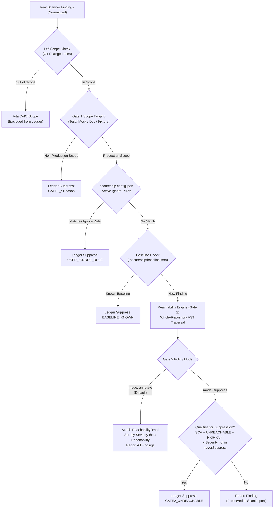
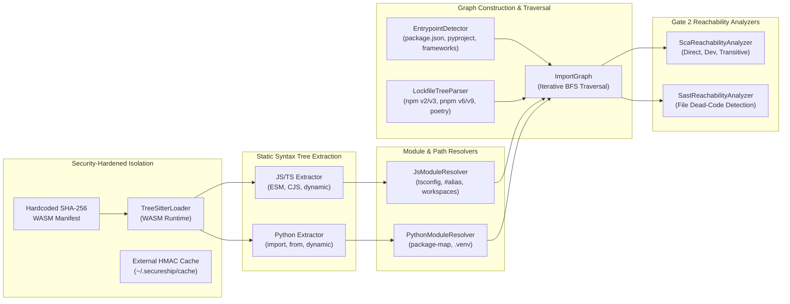

# SecureShip Phase 3: Reachability Engine (Gate 2) — Architecture & Technical Design

SecureShip Phase 3 introduces **Gate 2: The Reachability Engine**, a deterministic, memory-bounded, zero-network static analysis component that determines whether security findings in third-party dependencies or local source files are genuine production risks or unreferenced dead code.

---

## 1. High-Level Scan Pipeline Integration

Gate 2 operates as the analytical gate immediately following Gate 1 (scope tagging), ignore rule evaluation, and baseline checks:

---

## 2. Reachability Engine Internal Subsystems

The `@secureship/reachability` package is decomposed into isolated, single-responsibility modules:

---

## 3. Core Architecture Tenets & Security Model

### 3.1 WASM Supply Chain Attestation

- Five pre-compiled WebAssembly binaries (`tree-sitter.wasm`, JS, TS, TSX, Python) are bundled in `packages/reachability/wasm/`.
- Every binary is cryptographically verified against a compile-time hardcoded SHA-256 digest before being instantiated into memory.
- Load-time tampering or mismatch fails closed to `UNKNOWN` (`PARSE_FAILURE`).

### 3.2 External Tamper-Resistant Cache

- Per Amendment **A3**, AST extraction results are **never** stored inside the scanned target repository to prevent committed cache poisoning attacks.
- Caches are located in the user directory (`~/.secureship/cache` or `%LOCALAPPDATA%/secureship/cache`), keyed by the SHA-256 hash of the target repository's canonical realpath.
- Every cache entry is cryptographically authenticated using an HMAC-SHA256 signature generated with a machine-local, non-committed random key (permissions `0600`).
- The cache stores raw syntax facts only (specifiers, type-only flags, dynamic import presence), never resolved paths or verdicts.

### 3.3 Whole-Repository Graph Under Incremental Diff Mode

- Per Amendment **A2**, when `--diff` or `--staged` is used, the reachability graph is still constructed across the **whole** repository.
- Incremental scoping is applied exclusively to findings, never the graph.
- This guarantees that if a changed lockfile introduces an SCA vulnerability whose package is imported by an unchanged file, the package is correctly recognized as `REACHABLE_IMPORT`.

### 3.4 Leaf Direct Dependency Transitive Safety

- Per Amendment **A1**, an `UNREACHABLE` (`NOT_IMPORTED`, `analysisConfidence: HIGH`) verdict is allowed **strictly if**:
  1. The package is directly declared in `dependencies`.
  2. The lockfile tree proves zero other installed packages depend on it (leaf direct package).
  3. No dynamic require or eval markers exist in production scope.
  4. Zero parse errors or unresolved local imports exist in production files.
  5. The package name or module name is not referenced in scripts, configs, Dockerfiles, or string literals.
- If a package is pulled transitively by any production-reachable package, it is `REACHABLE_IMPORT` (`TRANSITIVE_VIA`).

### 3.5 Python SCA Confidence Ceiling (Rule C1)

- In Phase 3, Python SCA findings are **NEVER** assigned `UNREACHABLE` with `HIGH` confidence.
- Even when all 7 positive evidence preconditions hold (declared directly in `pyproject.toml`, 0 dependents in `poetry.lock`/`Pipfile.lock`, 0 imports across production files, 0 references in configs/scripts), Python SCA findings are capped at **`MEDIUM`** confidence (`analysisConfidence: 'MEDIUM'`).
- If top-level module mapping or virtual environment metadata is unavailable, the finding degrades to `verdict: UNKNOWN, evidence.kind: UNMAPPED_PACKAGE, analysisConfidence: LOW`.
- Because default Gate 2 suppression policy strictly requires `HIGH` confidence, **no Python SCA finding is ever automatically suppressed under default policy in Phase 3**.

### 3.6 Supported vs. Unsupported Dependency Lockfiles

- **Supported Dependency Tree Lockfiles:**
  - `package-lock.json`: Lockfile versions 2 and 3.
  - `pnpm-lock.yaml`: Lockfile versions 6.0 and 9.0.
  - `poetry.lock`: Standard Poetry lockfiles with package dependency tables.
  - `Pipfile.lock`: Standard Pipenv lockfiles with default and develop sections.
  - Python Virtual Environments: Local `.venv/` or `venv/` `.dist-info/top_level.txt` / `RECORD` metadata.
- **Unsupported Lockfiles (Fail-Closed to `UNKNOWN`):**
  - `uv.lock`: **Unsupported in Phase 3.** `uv.lock` is an unsupported flat/metadata format in Phase 3 without an AST dependency tree parser in `@secureship/reachability`; any repository relying exclusively on `uv.lock` degrades fail-closed to `verdict: UNKNOWN, evidence.kind: NO_LOCKFILE_TREE, analysisConfidence: LOW`.
  - `yarn.lock`: Degrades to `verdict: UNKNOWN, evidence.kind: NO_LOCKFILE_TREE`.
  - `bun.lock` / `bun.lockb`: Degrades to `verdict: UNKNOWN, evidence.kind: NO_LOCKFILE_TREE`.
  - Flat `requirements.txt`: Without parent-child dependency edges, degrades to `verdict: UNKNOWN, evidence.kind: NO_LOCKFILE_TREE`.
  - `package-lock.json` v1: Legacy format degrades to `verdict: UNKNOWN, evidence.kind: NO_LOCKFILE_TREE`.

### 3.7 Monorepo & Workspace Handling (Amendment A8)

- **Multi-Package Monorepos:** Inspects all workspace package manifests (`package.json` in `packages/*` for npm v2/v3, `importers/*` for pnpm v6/v9).
- **Case (b) - Shared Declaration, Single Usage:** Package declared in both workspace A and workspace B, but imported only by B => evaluated as `REACHABLE_IMPORT` (`PACKAGE_IMPORTED`) with chain from B.
- **Case (c) - Shared Declaration, Unimported:** Package declared in both workspace A and workspace B, and imported by neither => evaluated as `UNREACHABLE` (`NOT_IMPORTED-HIGH`) when all positive evidence preconditions hold across the entire monorepo.
- **Case (d) - Transitive Workspace Dependency:** Workspace A depends on workspace B, and workspace B imports the package => evaluated as `REACHABLE` (`TRANSITIVE_VIA` or `PACKAGE_IMPORTED`).
- **Case (e) - Unsupported Monorepo Lockfiles:** Monorepos utilizing `yarn.lock` or `bun.lock` degrade fail-closed to `UNKNOWN (NO_LOCKFILE_TREE)`.

### 3.8 Reference Scanner Bounded Resource Guardrails (Fix C6)

To protect CI environments from denial-of-service, hangs, or resource exhaustion when searching for non-standard package references:

1. **Per-File Size Cap:** Maximum **1 MB** per file (`1,048,576` bytes). Files exceeding 1 MB are skipped, and `incompleteScan: true` is flagged (`reason: "file exceeds 1 MB limit"`).
2. **Total Byte Budget:** Maximum **50 MB** (`52,428,800` bytes) total cumulative content scanned across all inspected files. Exceeding this budget triggers `incompleteScan: true` (`reason: "total reference scan budget exceeded 50 MB"`).
3. **Wall-Clock Timeout:** Maximum **10 seconds** wall-clock execution time. If scanning exceeds 10s, scanning aborts immediately and flags `incompleteScan: true` (`reason: "reference scan timed out after 10000 ms"`).
4. **Deterministic Traversal:** Directory traversal and candidate file evaluation follow strict lexicographical sorting order.
5. **Fail-Closed Guardrail:** Whenever `incompleteScan: true` is flagged, candidate `NOT_IMPORTED` findings **immediately degrade fail-closed to `UNKNOWN (CONFIG_REFERENCE)`** with `analysisConfidence: LOW`. A budget cap hit will **never** allow a package to be falsely classified as `UNREACHABLE-HIGH`.

---

## 4. Ledger Accounting Invariant P1

Every raw scanner finding is accounted for in exactly one category:

$$\text{totalRaw} = \text{totalReported} + \text{totalSuppressed} + \text{totalOutOfScope}$$

Where:
$$\text{totalSuppressed} = \text{gate1} + \text{ignoreRules} + \text{baseline} + \text{gate2Unreachable}$$

Suppressed findings are retained in the suppression ledger with code `GATE2_UNREACHABLE` and full explanatory evidence chains, ensuring complete auditability and zero silent drops.
