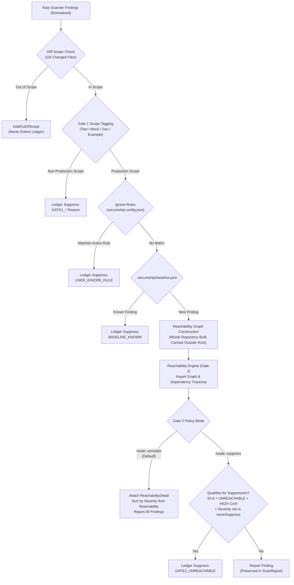
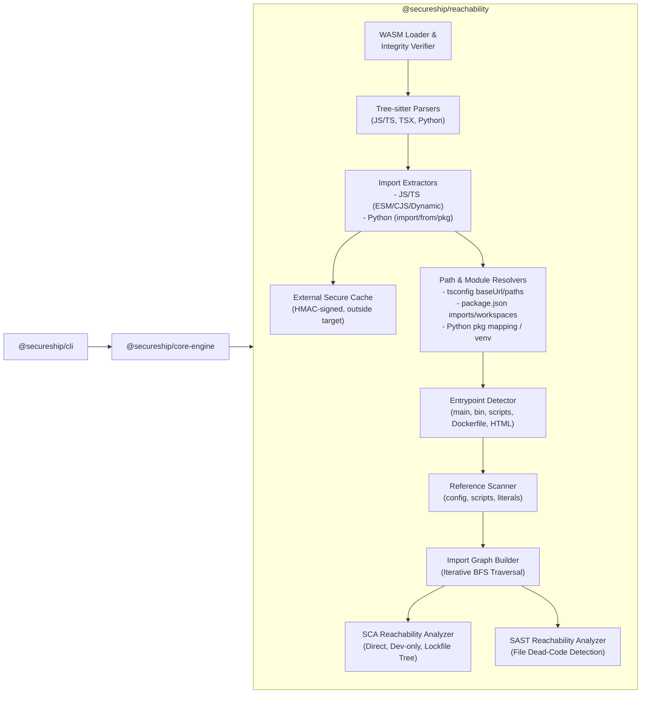

# SecureShip Phase 3: Reachability Engine (Gate 2) — Implementation Plan

## Goal

Implement **SecureShip Phase 3 ("REACHABILITY ENGINE (Gate 2)")** to production standard:

1. Determine whether a third-party dependency or local source file is genuinely used by production code using static syntax tree analysis with WebAssembly Tree-sitter.
2. Provide rank re-ordering and opt-in suppression (`--gate2 suppress`) for Software Composition Analysis (SCA) vulnerabilities without obscuring true security risks.
3. Restrict analysis strictly to **IMPORT-LEVEL** reachability for JavaScript/TypeScript and Python codebases. Function-level call-path reachability is explicitly out-of-scope for Phase 3 (`REACHABLE_CALL_PATH` remains unused and documented as such).
4. Strictly enforce positive evidence for `UNREACHABLE` verdicts (Principle G1); any ambiguity, dynamic execution pattern, parse error, or unresolved import degrades fail-closed to `UNKNOWN`.
5. Maintain 100% backward compatibility with Phase 1 and Phase 2 pipelines, accounting invariants, and existing test suites.

---

## Approved Amendments & Design Specifications

> [!IMPORTANT]
>
> ### A1. Transitive Hole Closure (Critical)
>
> `NOT_IMPORTED` (`UNREACHABLE`, `analysisConfidence: HIGH`) is allowed **ONLY** if:
>
> 1. The package is directly declared in a project manifest (`package.json`, `pyproject.toml`, `setup.py`, etc.).
> 2. A dependency tree proves no other installed package depends on it (npm `package-lock.json` v2/v3 including optional/peer/bundled edges; pnpm `pnpm-lock.yaml` v6/v9 edges; Python `poetry.lock`, `uv.lock`, `Pipfile.lock` edges or local venv `Requires-Dist` metadata).
>
> If a flat `requirements.txt`, `yarn.lock`, `bun.lock`, or no tree is available, the verdict degrades to `UNKNOWN` (`NO_LOCKFILE_TREE`). Any package that is a dependency of any production-reachable package is strictly `REACHABLE_IMPORT` (`TRANSITIVE_VIA`), never `NOT_IMPORTED`.

> [!IMPORTANT]
>
> ### A2. Diff Mode Reachability Scoping
>
> When running incremental scans (`--diff <ref>`, `--staged`), the Reachability Engine **MUST** build the import reachability graph from the **WHOLE** repository. The diff filter applies strictly to findings, never to the reachability graph. A finding in a changed lockfile whose package is imported by an unchanged source file is correctly marked `REACHABLE_IMPORT`.

> [!IMPORTANT]
>
> ### A3. External Secure Cache & Anti-Poisoning Architecture
>
> The AST extraction cache is stored **OUTSIDE** the scan target in the user cache directory (e.g., `process.env.LOCALAPPDATA/secureship/cache` on Windows, `~/.cache/secureship/cache` on Linux/macOS), partitioned by the SHA-256 hash of the target's real path.
>
> - Every cache entry is HMAC-signed with a per-machine random secret key stored with restricted permissions (`0600`).
> - The cache stores only raw per-file syntax extractions (imported specifiers, dynamic flags, parse status), **never** resolved filepaths or final reachability verdicts.
> - Any cache directory inside the target repository (such as `.secureship/cache`) is strictly ignored to eliminate cache poisoning attacks from malicious repositories.

> [!IMPORTANT]
>
> ### A4. Dev-Only & Type-Only Confidence Discipline
>
> Packages classified as `DEV_ONLY` or imports identified as type-only (`import type { ... }`) are never assigned `analysisConfidence: HIGH` (maximum `MEDIUM`). Consequently, they are **never auto-suppressed** in `--gate2 suppress` mode.
>
> - If a devDependency is referenced in build scripts, configs, or CI, it yields `UNKNOWN` (`CONFIG_REFERENCE`).
> - A package declared under `"dependencies"` but imported only from tests is NOT `DEV_ONLY` (it remains a production dependency unless moved to `devDependencies`).

> [!IMPORTANT]
>
> ### A5. Comprehensive Reference Scan Precondition
>
> Before assigning any `NOT_IMPORTED` verdict to an SCA finding, SecureShip performs a text scan across all repository non-ignored files (excluding `node_modules`, `.git`, lockfiles, build directories):
>
> - `package.json` scripts and binary invocations
> - `Dockerfile`, `docker-compose`, `Makefile`, shell scripts
> - CI workflows (`.github/workflows`, `.gitlab-ci.yml`, etc.)
> - Configuration files (`*.config.*`, `.*rc`, `.yaml`, `.yml`, `.toml`, `.json`, `.ini`, `.cfg`)
> - Python settings (`INSTALLED_APPS`-style strings) and string literals in production code matching the package or module name.
>   Any match immediately downgrades the verdict to `UNKNOWN` (`CONFIG_REFERENCE`).

> [!IMPORTANT]
>
> ### A6. Rigorous Parse & Resolution Preconditions
>
> A file is considered "parsed successfully" if and only if Tree-sitter's `rootNode.hasError` is `false` (no `ERROR` or `MISSING` nodes).
> In addition, there must be **zero unresolved local imports** (relative imports, `tsconfig` path aliases, `#imports`) in the production scope. Any parse error or unresolved local import degrades project-level `NOT_IMPORTED` verdicts to `UNKNOWN`.

> [!IMPORTANT]
>
> ### A7. Bidirectional Entrypoint Mapping
>
> - For packages whose `main`, `module`, `exports`, or `bin` point to build output (`dist/`, `lib/`, `build/`), SecureShip maps build paths back to source files using `tsconfig.json` `rootDir`/`outDir` mappings and export condition rules.
> - Published libraries: every exported module in `package.json` is treated as a root entrypoint.
> - HTML entrypoints: `<script src="...">` tags in `index.html`.
> - Best-effort Vite/Webpack/Rollup entrypoint discovery.
> - If an entrypoint cannot be resolved to a valid source file, file verdicts degrade to `UNKNOWN` (`NO_ENTRYPOINT`), never `UNREACHABLE`.

> [!IMPORTANT]
>
> ### A8. Monorepo Workspace Mapping
>
> Each lockfile and manifest entry is mapped to its owning workspace package. A dependency is marked `NOT_IMPORTED` only if **no workspace package** that depends on it imports it in production code.

> [!IMPORTANT]
>
> ### A9. Multi-Format Lockfile Coverage
>
> - Full dependency tree resolution for npm `package-lock.json` (v2 and v3 format, resolving `dev`, `optional`, and `peer` flags).
> - Full dependency tree resolution for pnpm `pnpm-lock.yaml` (both v6 and v9 formats).
> - Unsupported lockfile formats (`yarn.lock`, `bun.lock`, flat `requirements.txt`) emit `UNKNOWN` (`NO_LOCKFILE_TREE`) and are documented in `LIMITATIONS.md`.

> [!IMPORTANT]
>
> ### A10. Tolerant Contract Parsing for Backward Compatibility
>
> In `ScanSummarySchema`, `byReachability` is made **optional** when parsing input reports (allowing valid Phase 2 `1.0` reports to parse cleanly). When serializing new reports, writers always emit `schemaVersion: "1.1"` and include `byReachability`.

> [!IMPORTANT]
>
> ### A11. User-Facing Wording & Safety Messaging
>
> Terminal human output uses explicit, factual labels:
>
> - `[IMPORTED]` (for `REACHABLE_IMPORT`)
> - `[NOT IMPORTED]` (for `UNREACHABLE`)
> - `[UNKNOWN]` (for `UNKNOWN`)
>   In `--gate2 suppress` mode, the terminal prints an explicit banner stating the count of suppressed findings and guidance to inspect them with `--include-suppressed`.
>   SecureShip never describes an unimported package as "safe", and displays the mandatory disclosure:
>   `"Import-level analysis only; not proof of exploitability or safety."`

> [!IMPORTANT]
>
> ### A12. Tier Policy Integration
>
> Import-level reachability (both `annotate` and `suppress` modes) is included in the `FREE_BYOK` tier. Function-level call-path reachability is reserved for Pro and marked unbuilt. `secureship status` outputs:
>
> - `Import-level reachability: included`
> - `Function-level call-path: Pro, not yet available`

> [!IMPORTANT]
>
> ### A13. WASM Supply Chain & Upstream Provenance
>
> - Create `THIRD_PARTY_NOTICES.md` documenting upstream repositories, exact commits/versions, and permissive licenses for all 5 bundled grammar binaries.
> - Provide a `pnpm verify:wasm` script that re-verifies grammar binaries against the manifest.
> - Grammar staleness tests: test modern language constructs (Python 3.12 f-strings, `type` statements; TypeScript 5.x const type parameters) and ensure graceful degradation to `UNKNOWN`.

> [!IMPORTANT]
>
> ### A14. High-Yield Real-Repository Evaluation
>
> Evaluate 3 real open-source repositories pinned to exact commit SHAs (or older tags with outdated dependencies) to ensure at least 10 real SCA findings each, including direct, transitive, and devDependency findings:
>
> 1. **JS/TS:** A realistic Node.js repository with real lockfiles and dependencies (>= 10 real SCA findings).
> 2. **Python:** A realistic Python web/CLI application with lockfile/venv (>= 10 real SCA findings).
> 3. **Mixed/Monorepo:** A realistic multi-language or workspace monorepo (>= 10 real SCA findings).
>    Audit every `UNREACHABLE` verdict and at least 30 verdicts overall with manual source code reading; false-unreachable rate must be **0.0%**.

> [!IMPORTANT]
>
> ### A15. Rigorous Testing & Metric Definitions
>
> - Ground-truth fuzz testing: generate >= 300 random projects by construction with known reachable/unreachable graphs, asserting 0 false-unreachables.
> - Expanded metamorphic tests: verify verdict mutations when adding configs, scripts, dynamic imports, syntax errors, or removing entrypoints.
> - Safety sandbox tests: verify tampered WASM fails closed to `UNKNOWN`, path traversal canary files outside the workspace are never read, and zero network/subprocess calls are spawned by the reachability package.
> - Corpus suite >= 30 fixtures covering all edge cases.
> - `noiseReductionPercent` defined strictly as:
>   $$\text{noiseReductionPercent} = \frac{\text{gate2SuppressedCount}}{\text{totalReportedBeforeGate2}} \times 100$$
>   Display `N/A` if denominator is 0 (never report 100% on empty sets).

> [!IMPORTANT]
>
> ### A16. CI Trust Model Documentation
>
> In `LIMITATIONS.md` and `README.md`, document that repository-provided `secureship.config.json` files can weaken Gate 1/2 policies. In CI workflows analyzing untrusted PRs, configurations must be specified via a trusted CLI path (`--config`).

---

## Non-Negotiable Principles

| ID     | Principle                                   | Implementation Enforcement                                                                                                                                                                                                                                                                     |
| :----- | :------------------------------------------ | :--------------------------------------------------------------------------------------------------------------------------------------------------------------------------------------------------------------------------------------------------------------------------------------------- |
| **G1** | **Positive Evidence Required**              | An `UNREACHABLE` verdict requires complete positive proof that no production code or configuration references the entity. Any uncertainty, unmapped package, parse error, or dynamic reflection yields `UNKNOWN`.                                                                              |
| **G2** | **Default Annotate Mode**                   | Default mode is `annotate`: tags findings with reachability evidence and sorts reported findings (`REACHABLE_*` before `UNKNOWN` before `UNREACHABLE`), removing zero findings. `suppress` is strictly opt-in and restricted to SCA with `analysisConfidence: HIGH` and non-critical severity. |
| **G3** | **Accounting Invariant P1**                 | Every raw finding belongs to exactly one bucket: $\text{totalRaw} = \text{totalReported} + \text{totalSuppressed} + \text{totalOutOfScope}$. Suppressed findings are recorded in the ledger with reason `GATE2_UNREACHABLE`.                                                                   |
| **G4** | **Static & Safe**                           | Never execute analyzed code. Never run `npm`, `pip`, or build scripts. Zero outbound network calls. File imports attempting directory traversal outside the scan root (e.g. `../../etc/passwd`) are marked unresolved.                                                                         |
| **G5** | **Deterministic & Explainable**             | Identical inputs produce byte-identical outputs. Every verdict carries a detailed `ReachabilityDetail` evidence record containing the traversal chain, dependency path, or limitation notes.                                                                                                   |
| **G6** | **Bounded Resource Consumption**            | Files are protected by a 1 MB file size cap and a configurable per-file parse timeout (default 5,000 ms). Problematic files degrade gracefully to `UNKNOWN` with a warning, never crashing the scanner.                                                                                        |
| **G7** | **Backward Compatibility**                  | Existing Phase 1 and Phase 2 tests and configurations pass without regressions. ScanReport schema version moves to `1.1` while readers continue to accept `1.0`.                                                                                                                               |
| **G8** | **SECRET and IAC Findings are Never Gated** | SAST findings are evaluated at the file level only. SCA findings are evaluated at the package level. `SECRET` and `IAC` findings are never gated by reachability and always return `verdict: UNKNOWN, reason: NOT_APPLICABLE`.                                                                 |

---

## Non-Goals (Explicitly Excluded)

The following capabilities are deliberately out of scope for Phase 3:

- Function-level call graph construction or call-path analysis (`REACHABLE_CALL_PATH` remains unused).
- Inter-procedural taint analysis or dataflow analysis.
- Grammars for languages other than JS/TS and Python (all other languages emit `verdict: UNKNOWN, reason: UNSUPPORTED_LANGUAGE`).
- Gate 3 (AI triage), Gate 4 (sandbox verification), PR autofix/patch generation, telemetry, MCP server, IDE extensions, or license servers.

---

## Step 0 Spike Results & Dependency Evaluation

### Empirical Validation on Windows with Node.js 24 (`v24.19.0`)

A standalone spike was executed validating `web-tree-sitter` (version `0.22.6`, MIT License) and `tree-sitter-wasms` (version `0.1.13`, Unlicense).
The parser successfully initialized, loaded the WASM grammar binaries, parsed JavaScript, TypeScript, TSX, and Python syntax trees, and traversed import AST nodes with zero native compilation.

```
Testing Parser.init()...
Loading grammar: tree-sitter-javascript.wasm (sha256: 63812b9e275d2685...)
  Parsed JS/TS code. Root node: program, children: 3
Loading grammar: tree-sitter-typescript.wasm (sha256: 8515404dceed38e1...)
  Parsed JS/TS code. Root node: program, children: 3
Loading grammar: tree-sitter-tsx.wasm (sha256: 6aa3b2c70e76f5d4...)
Loading grammar: tree-sitter-python.wasm (sha256: 9056d0fb0c337810...)
  Parsed Python code. Root node: module, children: 3
SPIKE_SUCCESS
```

### Pinned Dependencies & Cryptographic Manifest

| Dependency          | Exact Version | License   | Postinstall Script | Purpose                                |
| :------------------ | :------------ | :-------- | :----------------- | :------------------------------------- |
| `web-tree-sitter`   | `0.22.6`      | MIT       | None               | WebAssembly Tree-sitter parser runtime |
| `tree-sitter-wasms` | `0.1.13`      | Unlicense | None               | Pre-compiled grammar binaries          |

#### Verified SHA-256 Checksums

| WASM Binary                   | Size (Bytes) | SHA-256 Checksum                                                   |
| :---------------------------- | :----------- | :----------------------------------------------------------------- |
| `tree-sitter.wasm`            | 188,635      | `29208e71028ab0c11dfcc941255075aad75545394467aa22d817a6356714090f` |
| `tree-sitter-javascript.wasm` | 647,334      | `63812b9e275d26851264734868d27a1656bd44a2ef6eb3e85e6b03728c595ab5` |
| `tree-sitter-typescript.wasm` | 2,342,690    | `8515404dceed38e1ed86aa34b09fcf3379fff1b4ff9dd3967bcd6d1eb5ac3d8f` |
| `tree-sitter-tsx.wasm`        | 2,411,272    | `6aa3b2c70e76f5d48eafef1093e9c4de383e13f2fdde2f4e9b98a378f6a8f1b6` |
| `tree-sitter-python.wasm`     | 476,105      | `9056d0fb0c337810d019fae350e8167786119da98f0f282aceae7ab89ee8253b` |

---

## Architecture

### 1. High-Level Scan Pipeline with Gate 2



### 2. Reachability Engine Component Graph



---

## Proposed Changes per File

### `@secureship/contracts`

#### [NEW] `packages/contracts/src/reachability.schema.ts`

- Define `ReachabilityEvidenceKindSchema`:
  `'IMPORT_CHAIN' | 'PACKAGE_IMPORTED' | 'TRANSITIVE_VIA' | 'DEV_ONLY' | 'NOT_IMPORTED' | 'DEAD_FILE' | 'CONFIG_REFERENCE' | 'DYNAMIC_UNKNOWN' | 'NO_ENTRYPOINT' | 'UNSUPPORTED_LANGUAGE' | 'UNMAPPED_PACKAGE' | 'NO_LOCKFILE_TREE' | 'NOT_APPLICABLE' | 'PARSE_FAILURE'`
- Define `ReachabilityDetailSchema`:
  - `verdict: ReachabilitySchema`
  - `analysisConfidence: ConfidenceSchema` (`HIGH | MEDIUM | LOW`)
  - `evidence: { kind: ReachabilityEvidenceKind, chain?: string[] (max 10 posix paths), via?: string[], notes?: string }`
  - `limitations: z.array(z.string())`
- Export TypeScript types.

#### [MODIFY] `packages/contracts/src/finding.schema.ts`

- Add optional `reachabilityDetail?: ReachabilityDetailSchema` to `NormalizedFindingSchema`.

#### [MODIFY] `packages/contracts/src/suppression.schema.ts`

- Add `'GATE2_UNREACHABLE'` to `SuppressionReasonCodeSchema`.

#### [MODIFY] `packages/contracts/src/config.schema.ts`

- Add strict `Gate2ConfigSchema`:
  - `mode: z.enum(['off', 'annotate', 'suppress']).default('annotate')`
  - `neverSuppressSeverities: z.array(SeveritySchema).default(['CRITICAL'])`
  - `entrypoints: z.array(z.string()).optional()`
  - `extraTestGlobs: z.array(z.string()).optional()`
  - `maxFileBytes: z.number().int().positive().default(1_048_576)`
  - `parseTimeoutMs: z.number().int().positive().default(5000)`
- Add `gate2: Gate2ConfigSchema.default({})` to `ConfigSchema`.

#### [MODIFY] `packages/contracts/src/scan-report.schema.ts`

- Update `schemaVersion: z.enum(['1.0', '1.1']).default('1.1')`.
- In `ScanSummarySchema`, `byReachability: z.record(ReachabilitySchema, z.number().int().nonnegative()).optional()` (making it optional for parsing older 1.0 reports, while writers populate it).

#### [MODIFY] `packages/contracts/src/tier-policy.schema.ts`

- Update tier capabilities text:
  - `importReachability: true` (included in FREE_BYOK)
  - `callPathReachability: false` (Pro, unbuilt)

#### [MODIFY] `packages/contracts/src/index.ts`

- Re-export all new reachability types and schemas.

---

### `@secureship/reachability` (NEW PACKAGE)

#### [NEW] `packages/reachability/package.json`

- Monorepo package `@secureship/reachability` depending only on `@secureship/contracts` and `@secureship/core-engine`.
- Pinned runtime dependencies: `web-tree-sitter: "0.22.6"`.
- Dev dependencies: `tree-sitter-wasms: "0.1.13"`.

#### [NEW] `packages/reachability/wasm/*`

- Bundle the 5 verified wasm files:
  - `tree-sitter.wasm`
  - `tree-sitter-javascript.wasm`
  - `tree-sitter-typescript.wasm`
  - `tree-sitter-tsx.wasm`
  - `tree-sitter-python.wasm`

#### [NEW] `packages/reachability/src/manifest/wasm-manifest.ts`

- Hardcoded SHA-256 hashes and file sizes for each bundled `.wasm` file.
- `verifyWasmIntegrity(wasmPath, expectedHash)` function.

#### [NEW] `packages/reachability/src/parsers/tree-sitter-loader.ts`

- Loads `web-tree-sitter` once and initializes language grammars on demand.
- Validates SHA-256 integrity of grammar files before loading into memory.
- Guards against invalid files with file size cap (`maxFileBytes`) and parse timeout (`parseTimeoutMs`).
- Checks `rootNode.hasError` strictly.

#### [NEW] `packages/reachability/src/js/js-import-extractor.ts`

- Extracts ESM `import ... from '...'`, `export ... from '...'`, `import('...')`, CommonJS `require('...')`.
- Flags type-only imports (`import type { ... }` or `import { type X }`): never grants `analysisConfidence: HIGH`.
- Detects non-literal requires/imports (`require(variable)`, `import(dynamic)`), `eval()`, `new Function()` and flags file as `hasDynamicImports: true`.

#### [NEW] `packages/reachability/src/js/js-module-resolver.ts`

- Resolves relative paths (`./`, `../`) with `.js`, `.ts`, `.tsx`, `.jsx`, `.mjs`, `.cjs`, `.json`, and `/index` resolution.
- Resolves `tsconfig.json` `baseUrl` and `paths` aliases (strictly inside project root; rejects directory escape).
- Resolves `package.json` `"imports"` (`#alias`) and monorepo workspace packages.
- Normalizes bare specifiers to root package names.
- Ignores Node.js built-ins (`node:*`, `fs`, `path`, etc.).

#### [NEW] `packages/reachability/src/python/python-import-extractor.ts`

- Extracts Python `import module`, `from module import name`, and relative imports (`.`, `..`).
- Counts imports inside functions, classes, and `try/except` blocks.
- Detects dynamic imports: `importlib.import_module(var)`, `__import__(var)`, `eval()`, `exec()`.

#### [NEW] `packages/reachability/src/python/python-module-resolver.ts` & `package-map.ts`

- Maps package names to imported module names using static mapping table:
  - `PyYAML` -> `yaml`, `Pillow` -> `PIL`, `beautifulsoup4` -> `bs4`, `scikit-learn` -> `sklearn`, `opencv-python` -> `cv2`, `python-dateutil` -> `dateutil`, `attrs` -> `attr`, `protobuf` -> `google.protobuf`, etc.
- Inspects local virtual environment (`.venv/`, `venv/`) `top_level.txt` and `Requires-Dist` if present.
- Unmapped Python package yields `UNKNOWN` (`UNMAPPED_PACKAGE`), never `UNREACHABLE`.

#### [NEW] `packages/reachability/src/entrypoints/entrypoint-detector.ts`

- Detects JS/TS entrypoints: `package.json` (`main`, `module`, `exports`, `bin`, `scripts`), framework conventions, `<script src>` in `index.html`, Dockerfile `CMD`/`ENTRYPOINT`.
- Maps build output paths (`dist/`, `lib/`) back to source files via `tsconfig` `rootDir`/`outDir`.
- Detects Python entrypoints: `__main__.py`, `pyproject.toml` `[project.scripts]`, `setup.py` `entry_points`, `manage.py`, `wsgi.py`, `asgi.py`, Dockerfile `CMD`/`ENTRYPOINT`.
- Merges user-configured `entrypoints` from `secureship.config.json`.
- Excludes test/mock/doc files from being production entrypoints.
- If zero entrypoints found or entrypoint cannot be resolved to source, yields `UNKNOWN` (`NO_ENTRYPOINT`).

#### [NEW] `packages/reachability/src/reference/reference-scanner.ts`

- Scans non-ignored repository text files for package/module name references before any `NOT_IMPORTED` verdict. Any hit degrades verdict to `UNKNOWN` (`CONFIG_REFERENCE`).

#### [NEW] `packages/reachability/src/graph/import-graph.ts`

- Directed graph tracking file nodes, package imports, external dependencies, dynamic markers, and unresolved imports.
- Iterative BFS traversal from production entrypoint roots to calculate reachability distance and path chains (capped at 10 POSIX paths).
- Cycle-safe with visited set memoization.
- Always built across the entire repository regardless of diff mode.

#### [NEW] `packages/reachability/src/lockfile/lockfile-tree-parser.ts`

- Parses `package-lock.json` (v2 and v3 format) with dev/optional/peer flags.
- Parses `pnpm-lock.yaml` (v6 and v9 format).
- Computes transitive dependency parent chains: resolves if a transitive vulnerability is pulled via an active production direct dependency.
- Unsupported formats (`yarn.lock`, `bun.lock`, flat `requirements.txt`) yield `UNKNOWN` (`NO_LOCKFILE_TREE`).

#### [NEW] `packages/reachability/src/sca/sca-reachability-analyzer.ts`

- Direct dependencies: imported from reachable production file => `REACHABLE_IMPORT` (`PACKAGE_IMPORTED`, `HIGH`).
- Dev-only dependencies: declared only in `devDependencies` / dev groups and referenced only in tests/build scripts => `UNREACHABLE` (`DEV_ONLY`, `MEDIUM` - never auto-suppressed).
- Transitive dependencies: parent chain traced to production direct dependency => `REACHABLE_IMPORT` (`TRANSITIVE_VIA`, `MEDIUM`); if lockfile tree missing => `UNKNOWN` (`NO_LOCKFILE_TREE`).
- `NOT_IMPORTED` (`UNREACHABLE`, `HIGH`) rule: strictly enforced per Amendment A1, A5, and A6.

#### [NEW] `packages/reachability/src/sast/sast-reachability-analyzer.ts`

- File-level SAST analysis:
  - If file is reachable from entrypoint => `REACHABLE_IMPORT` (`IMPORT_CHAIN`, `HIGH`).
  - If file is unreachable => `UNREACHABLE` (`DEAD_FILE`), but confidence is capped at `LOW` (since frameworks may load files implicitly), ensuring it is never auto-suppressed.
  - Gate 1 `TEST_OR_MOCK` verdicts are never overwritten by weaker Gate 2 verdicts.

#### [NEW] `packages/reachability/src/cache/external-cache.ts`

- Secure cache outside target directory (in user cache dir) with HMAC integrity and atomic writes.
- Caches raw per-file syntax extractions only.
- Completely ignores `.secureship/cache` inside target repos.

---

### `@secureship/core-engine`

#### [MODIFY] `packages/core-engine/src/orchestrator/scan-orchestrator.ts`

- Integrate Gate 2 into pipeline:
  `Diff Scoping -> Gate 1 -> Ignore Rules -> Baseline -> Reachability Engine (Whole Repo Graph) -> Gate 2 Policy -> Ledger / Reported`
- In `annotate` mode: attach `reachabilityDetail`, sort reported findings deterministically by severity (`CRITICAL` -> `HIGH` -> `MEDIUM` -> `LOW` -> `INFO`), then reachability (`REACHABLE_CALL_PATH` -> `REACHABLE_IMPORT` -> `UNKNOWN` -> `UNREACHABLE`), then tie-breakers.
- In `suppress` mode: evaluate qualifying SCA findings (`category === 'SCA'`, `verdict === 'UNREACHABLE'`, `analysisConfidence === 'HIGH'`, `severity` not in `neverSuppressSeverities`). Move qualifying findings to `ledger.suppress(finding, 'GATE2_UNREACHABLE', detail, 'Gate 2 Reachability Engine')`.
- All reported findings count towards `--fail-on` (suppressed findings naturally excluded).

#### [MODIFY] `packages/core-engine/src/suppression/ledger.ts`

- Support `GATE2_UNREACHABLE` in `suppressedByReason`.
- Aggregate `byReachability` in `ScanSummary`.

#### [MODIFY] `packages/core-engine/src/report/report-builder.ts`

- Support schema version `1.1` and `byReachability` summary fields.

---

### `@secureship/cli`

#### [MODIFY] `packages/cli/src/commands/scan.ts`

- Add `--gate2 <off|annotate|suppress>` (default: `annotate`).
- Add `--no-cache` flag.
- Display reachability tags in terminal output (`[IMPORTED]`, `[NOT IMPORTED]`, `[UNKNOWN]`).
- Display mandatory disclosure: `"Import-level analysis only; not proof of exploitability or safety."`
- Display detailed evidence chain when `--verbose` is provided.
- In `--gate2 suppress` mode, print banner with count suppressed and `--include-suppressed` tip.
- Terminal summary table displays findings breakdown by reachability and Gate 2 suppression impact.

#### [NEW] `packages/cli/src/commands/graph.ts`

- Implement `secureship graph [path] [--json] [--format dot]`
- Output entrypoints, node/edge counts, dynamic files, unresolved imports, and parse failures.

#### [MODIFY] `packages/cli/src/commands/doctor.ts`

- Add WASM grammar integrity verification check in `secureship doctor` output.

#### [MODIFY] `packages/cli/src/commands/status.ts`

- Update status command text:
  - `"Import-level reachability: included"`
  - `"Function-level call-path: Pro, not yet available"`

#### [MODIFY] `packages/cli/src/index.ts`

- Register `graph` command and new options for `scan`.

---

### `@secureship/benchmark`

#### [MODIFY] `packages/benchmark/src/metrics.ts`

- Add reachability metrics:
  - `falseUnreachableCount`: findings marked `UNREACHABLE` whose ground truth is reachable (hard threshold: **0**).
  - `reachabilityAccuracy`: accuracy per reachability class.
  - `unknownRate`: proportion of findings with `UNKNOWN`.
  - `noiseReductionPercent`: $\frac{\text{gate2SuppressedCount}}{\text{totalReportedBeforeGate2}} \times 100$ (display `N/A` if denominator is 0).

#### [NEW] `packages/benchmark/corpus/gate2/*` (>= 30 cases)

- Create comprehensive test fixtures covering all standard cases plus Amendments A1-A15 edge cases:
  1. `prod-import-esm` (REACHABLE)
  2. `prod-import-cjs` (REACHABLE)
  3. `test-only-import` (UNREACHABLE / DEV_ONLY, MEDIUM)
  4. `dev-only-dependency` (UNREACHABLE / DEV_ONLY, MEDIUM)
  5. `transitive-via-prod` (REACHABLE)
  6. `transitive-via-dev-only` (UNREACHABLE, MEDIUM)
  7. `type-only-import` (UNREACHABLE, MEDIUM)
  8. `dynamic-import-var` (UNKNOWN, DYNAMIC_UNKNOWN)
  9. `dynamic-require-eval` (UNKNOWN, DYNAMIC_UNKNOWN)
  10. `config-only-usage` (UNKNOWN, CONFIG_REFERENCE)
  11. `script-bin-usage` (UNKNOWN, CONFIG_REFERENCE)
  12. `tsconfig-path-alias` (REACHABLE)
  13. `tsconfig-baseurl` (REACHABLE)
  14. `reexport-chain` (REACHABLE)
  15. `workspace-package` (REACHABLE)
  16. `circular-imports` (REACHABLE)
  17. `dead-file-sast` (UNREACHABLE, DEAD_FILE, LOW)
  18. `python-alias-pyyaml` (REACHABLE)
  19. `python-alias-pillow` (REACHABLE)
  20. `python-conditional-import` (REACHABLE)
  21. `python-unmapped-package` (UNKNOWN, UNMAPPED_PACKAGE)
  22. `unsupported-language-go` (UNKNOWN, UNSUPPORTED_LANGUAGE)
  23. `no-entrypoint-found` (UNKNOWN, NO_ENTRYPOINT)
  24. `lockfile-tree-missing` (UNKNOWN, NO_LOCKFILE_TREE)
  25. `declared-unused-transitive-of-prod` (REACHABLE, TRANSITIVE_VIA)
  26. `flat-requirements-python` (UNKNOWN, NO_LOCKFILE_TREE)
  27. `dockerfile-referenced-package` (UNKNOWN, CONFIG_REFERENCE)
  28. `syntax-error-file` (UNKNOWN, PARSE_FAILURE)
  29. `python-modern-syntax-file` (UNKNOWN or REACHABLE, never UNREACHABLE)
  30. `two-workspace-monorepo` (REACHABLE / UNREACHABLE depending on workspace usage)
  31. `diff-mode-lockfile-changed` (REACHABLE via unchanged prod file)

---

## Verification Plan

### Automated Tests

1. **Unit Tests (`packages/reachability/test/`)**:
   - JS/TS import extraction: ESM imports, CJS `require`, dynamic imports, type-only imports, export-from.
   - Module resolution: relative paths, `.ts`/`.js` extensions, `index.ts`, `tsconfig.json` path mappings, root traversal safety.
   - Python import extraction: `import`, `from ... import`, relative imports, conditional imports, dynamic reflection.
   - Package mapping & venv `top_level.txt` / `Requires-Dist` inspection.
   - Entrypoint detection across JS and Python stacks including build output back-mapping.
   - Lockfile tree parsers: `package-lock.json` (v2 & v3), `pnpm-lock.yaml` (v6 & v9).
   - Reference scanner across scripts, configs, and string literals.
   - Iterative BFS import graph traversal with circular references.
   - Decision table test for SCA positive evidence verification.
   - External secure cache: HMAC verification, atomic writes, cache poisoning rejection (committed `.secureship/cache` ignored).
2. **Metamorphic Tests**:
   - Adding a dynamic import flips verdict from `UNREACHABLE` to `UNKNOWN`.
   - Adding a real production import flips verdict from `UNREACHABLE` to `REACHABLE_IMPORT`.
   - Adding a config/script reference flips verdict to `UNKNOWN`.
   - Adding a syntax error flips project `NOT_IMPORTED` to `UNKNOWN`.
   - Renaming or reordering unreferenced files never alters reachability verdicts.
3. **Hostile Input & Safety Tests**:
   - Oversized file (> 1 MB), deeply nested AST, binary file with `.js` extension, invalid syntax, symlink loops, imports escaping root (`../../etc/passwd`).
   - Tampered WASM binary fails closed to `UNKNOWN`.
   - Canary file outside workspace is never read.
   - Reachability engine invokes zero child processes and zero network requests (verified with spies).
4. **Fuzz Tests**:
   - Ground-truth fuzz test generating >= 300 random small projects asserting zero false-UNREACHABLE.
5. **Ledger Invariant Property Tests**:
   - Property-based testing with >= 500 generated scenarios verifying $\text{totalRaw} = \text{totalReported} + \text{totalSuppressed} + \text{totalOutOfScope}$ with Gate 2 active.
6. **CLI E2E Tests**:
   - `secureship scan --gate2 annotate`
   - `secureship scan --gate2 suppress`
   - `secureship graph --json`
   - `secureship graph --format dot`
   - `secureship doctor` displaying WASM grammar manifest check.
   - `secureship status` displaying updated reachability capabilities.
7. **Benchmark Replay & Live Tests**:
   - `pnpm benchmark:replay` and `pnpm benchmark:live` verifying 0 false-unreachables across all >= 30 corpus cases.
8. **Code Coverage Enforcement**:
   - Every package, including `@secureship/reachability`, maintains >= 85% line coverage and >= 75% branch coverage.

### Real-Repository Evaluation (`docs/phase3/EVALUATION.md`)

- Clone 3 high-yield real open-source repositories outside the workspace pinned to exact commits:
  1. JS/TS repository yielding >= 10 real SCA findings with lockfile.
  2. Python repository yielding >= 10 real SCA findings with lockfile/venv.
  3. Mixed or monorepo yielding >= 10 real SCA findings.
- Execute live scans with all active security engines.
- Manually spot-check every `UNREACHABLE` verdict and at least 30 verdicts overall using independent source analysis.
- Document exact repository commits, scanner versions, tool commands, manual inspection notes, and match rates.

---

## Supply Chain & Documentation Deliverables

- `THIRD_PARTY_NOTICES.md` documenting upstream repos, versions, and permissive licenses for all grammar wasms.
- `scripts/verify-wasm.ts` and `pnpm verify:wasm` checking SHA-256 integrity against the manifest.
- `docs/phase3/ARCHITECTURE.md` (detailed Mermaid architecture).
- `docs/phase3/LIMITATIONS.md` (stating non-call-path nature, framework limitations, trust model for PR configs).
- `docs/phase3/EVALUATION.md` (full audit log of the 3 real-world repos).
- `README.md` and `CHANGELOG.md` updates.
