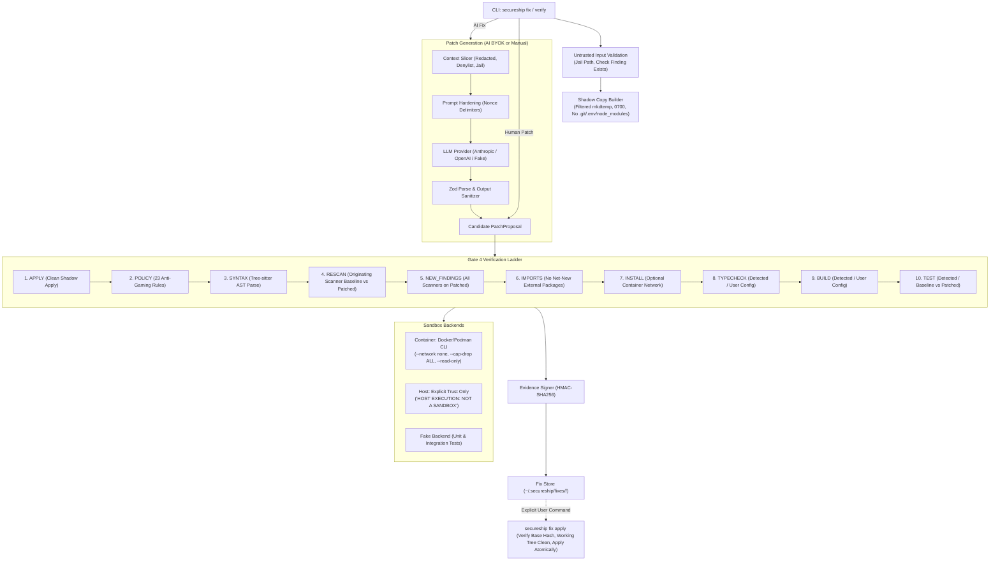
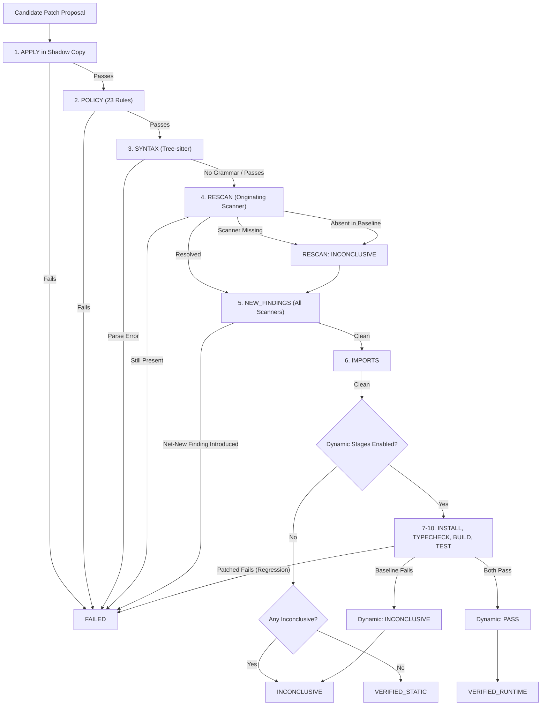

# SecureShip Phase 5: Gate 4 Verified Remediation Architecture

## 1. Executive Overview

SecureShip Phase 5 implements **Gate 4 Verified Remediation**: a deterministic, single-finding remediation and verification engine designed to generate candidate patches (via AI BYOK opt-in) or evaluate human-written patches (`verify`), apply them strictly inside an isolated shadow copy outside the repository, evaluate them across a 10-stage verification ladder, and generate an HMAC-signed evidence bundle.

---

## 2. Core Architectural Principles

1. **Untouchable Working Tree**: The developer's live working directory is **never** touched during candidate patch generation, syntax parsing, originating scanner re-scanning, new findings analysis, container builds, or test executions. The working tree changes _only_ when the developer explicitly executes `secureship fix apply <id>`.
2. **Deterministic Single-Finding Remediation**: Remediation targets exactly one finding at a time to prevent complex regressions, conflicting changes, or cascading patch errors.
3. **Honest & Conservative Claims**: Verification claims are narrow and precise: `VERIFIED_STATIC` or `VERIFIED_RUNTIME` state that the listed checks passed—never that code is "secure", "fixed", or that business logic is guaranteed preserved. `INCONCLUSIVE` is a first-class outcome when tools or baselines cannot confirm results.
4. **Sandboxed & Contained Execution**: Untrusted repository build and test scripts execute inside a container sandbox (`--network none`, `--cap-drop ALL`, `--security-opt no-new-privileges`, `--read-only`, non-root, memory/cpu/pid limits). Host execution strictly requires typed phrase confirmation: `"I trust repository <path> to run un-sandboxed code on my machine"` and is visibly branded `HOST EXECUTION: NOT A SANDBOX`.
5. **Strict Anti-Gaming & Patch Policy Engine**: Diffs are parsed by a zero-dependency strict unified diff parser. Diffs that add suppression markers, delete/edit tests or configs, add net-new dangerous APIs, add unapproved dependencies, hide Trojan Source Unicode, or only delete code are deterministically rejected with distinct violation codes.
6. **Zero New Runtime Dependencies**: Container sandboxing operates directly via Docker/Podman CLI using `SafeProcessRunner`. Diff parsing, patch application, and policy validation are implemented natively with zero external npm dependencies.

---

## 3. Subsystem Breakdown

### 3.1 `@secureship/patch-engine`

`@secureship/patch-engine` is a zero-dependency package providing diff parsing, pure patch application, atomic writes, and anti-gaming policy evaluation.

- **`DiffParser`** (`diff-parser.ts`):
  - Strictly parses unified diffs verifying headers (`--- a/...`, `+++ b/...`), hunks (`@@ -l,s +l,s @@`), and line count integrity.
  - Rejects mode changes (`MODE_CHANGE`), binary patches (`BINARY_PATCH`), symlinks (`SYMLINK`), new files (`NEW_FILE`), deleted files (`DELETE_FILE`), file renames (`RENAME`), path traversals, and absolute/UNC paths (`OUTSIDE_ROOT`).
  - Normalizes paths to POSIX format.
- **`PatchApplier`** (`applier.ts`):
  - Pure function `apply(originalText, parsedFile)` returning patched text.
  - Exact context matching at target line with +/- 20 lines fallback window. Ambiguous matches fail closed with `CONTEXT_MISMATCH`.
  - Preserves CRLF/LF line endings, UTF-8 BOM, and trailing newlines. Rejects mixed line endings (`EOL_INCONSISTENT`).
  - `atomicWrite(targetPath, content)` writes to a unique temporary file in the target directory and executes an atomic `renameSync` to eliminate race conditions and partial file corruptions.
- **`PatchPolicyEngine`** (`policy-engine.ts`):
  - Enforces 23 safety rules in strict deterministic order.
  - Checks scope boundaries, sensitive denylist patterns, test/fixture exclusions, and protected infrastructure configs.
  - Enforces anti-gaming rules: suppression comment detection (Semgrep, Gitleaks, Checkov, Trivy, ESLint, TypeScript, Python), commented-out code detection, removal-only patch rejection, and excessive deletion thresholds.
  - Computes per-hunk dangerous API differentials (`eval`, `child_process`, `pickle`, `yaml.load`, network calls) to ensure patches never introduce net-new dangerous calls.
  - Audits added dependencies against Node builtins, Python stdlib, and existing project package manifests.
  - Scans for Trojan Source bidirectional characters and hidden zero-width Unicode.

### 3.2 `@secureship/sandbox`

`@secureship/sandbox` manages isolated execution environments, shadow copies, and comparative baseline vs patched execution.

- **`ShadowCopy`** (`shadow/shadow-copy.ts`):
  - Creates an isolated copy of the repository in `$TEMP` (`mkdtemp`, `0700`).
  - Filters out `.git`, `node_modules`, virtualenvs, build outputs, files > 5MB, and sensitive denylist files (`.env*`, `*.pem`, `*.key`).
  - Builds an internal SHA-256 manifest of all copied files.
  - `verifyOriginalUnchanged()` verifies that the developer's live working tree has not been modified.
  - Signal and exit hooks ensure shadow copies are cleaned up without orphan leaks.
- **`ContainerBackend`** (`backends/container-backend.ts`):
  - Orchestrates Docker/Podman CLI execution via `SafeProcessRunner`.
  - Container flags: `--rm`, `--network=none` (or `--network=bridge` only for install stage), `--cap-drop=ALL`, `--security-opt=no-new-privileges`, `--pids-limit`, `--memory`, `--memory-swap`, `--cpus`, `--user=1000:1000`, `--read-only`, `--tmpfs=/tmp:rw`, `--workdir=/work`, bind mount of shadow directory only at `/work`, `--pull=never`, `--label=secureship.run=<id>`.
  - Windows host path translation (`C:\...` -> `/c/...`).
  - Label-based container cleanup on termination or abort.
- **`HostBackend`** (`backends/host-backend.ts`):
  - Executes commands directly on the host only when repository realpath hash is explicitly recorded in `trustedHostRepos`.
  - Requires typed interactive phrase confirmation: `"I trust repository <path> to run un-sandboxed code on my machine"`.
  - Displays visible warning banner: `HOST EXECUTION: NOT A SANDBOX`.
- **`BaselineRunner`** (`runner/baseline-runner.ts`):
  - Executes dynamic stages comparatively: runs unpatched baseline copy first.
  - If baseline fails, returns `INCONCLUSIVE` (cannot verify regression without clean baseline).
  - If baseline passes and patched fails, reruns once to detect flakiness; if still failing, returns `FAIL` with regression details.

### 3.3 `@secureship/ai` (Remediation Extensions)

`@secureship/ai` extends AI capabilities to generate candidate patches for eligible findings.

- **`FixPromptBuilder`** (`remediation/fix-prompt-builder.ts`):
  - Wraps redacted finding context and code slices inside random dynamic nonce delimiters.
  - Enforces minimal JSON response schema (`summary`, `diff`, `rationale`, `assumptions`, `risks`).
  - Forbids commentary, markdown prose outside JSON, and net-new external libraries.
- **`FixGenerator`** (`remediation/fix-generator.ts`):
  - Checks category eligibility: SAST and IAC only. Explicitly rejects SECRET, SCA, and credential-class CWEs.
  - Validates model output against `PatchProposalSchema`. On malformed JSON, executes one repair attempt.
  - Evaluates candidate proposal against `PatchPolicyEngine`. If policy violations occur, executes one retry with bounded, redacted violation feedback.
  - Caches proposals in external HMAC-signed cache.

### 3.4 `@secureship/core-engine` (Remediation Extensions)

- **`VerificationLadder`** (`remediation/verification-ladder.ts`):
  - Orchestrates all 10 stages:
    1. `APPLY`: Clean apply in isolated patched shadow copy.
    2. `POLICY`: 23 anti-gaming policy safety rules.
    3. `SYNTAX`: Tree-sitter AST error node validation across all modified files.
    4. `RESCAN`: Originating scanner re-scan (must reproduce in baseline, must be absent in patched).
    5. `NEW_FINDINGS`: All configured scanners run on patched copy; rejects net-new findings >= configured severity floor.
    6. `IMPORTS`: Validates imports against standard library and package manifests.
    7. `INSTALL`: Sandbox dependency installation (optional, network enabled if configured).
    8. `TYPECHECK`: Typecheck script detection and comparative execution.
    9. `BUILD`: Build script detection and comparative execution.
    10. `TEST`: Test suite detection and comparative execution.
  - Computes overall status: `VERIFIED_RUNTIME`, `VERIFIED_STATIC`, `UNVERIFIED`, `INCONCLUSIVE`, or `FAILED`.
  - Signs evidence bundle using per-machine HMAC-SHA256 secret.
- **`FixStore`** (`remediation/fix-store.ts`):
  - Stores fix proposals and signed reports outside repository in `~/.secureship/fixes/<repoHash>/<fixId>/`.
  - Verifies HMAC signature before retrieval or apply.
  - `applyFix`: verifies clean Git status, compares base file SHA-256 hashes against current disk files, applies patch atomically, and preserves EOL/BOM without auto-committing or auto-branching.

### 3.5 `@secureship/cli`

- **`secureship fix <id>`**: Generates and verifies remediation patch for finding `<id>`.
- **`secureship fix apply <id>`**: Atomically applies verified fix bundle to developer working tree.
- **`secureship fix list` / `show` / `discard`**: Inspects and manages stored candidate fix bundles.
- **`secureship verify <patch> --finding <id>`**: Evaluates human-written unified diff through Gate 4 ladder without invoking AI.
- **`secureship sandbox status|doctor|enable|disable|trust-host|cleanup`**: Manages sandbox readiness and execution backends.

---

## 4. Verification Ladder Decision Matrix

| Ladder Outcome         | Condition                                                                         |                 Exit Code                 |
| :--------------------- | :-------------------------------------------------------------------------------- | :---------------------------------------: |
| **`VERIFIED_RUNTIME`** | All static stages passed + at least one dynamic stage passed with clean baseline. | `0` (if `--require <= VERIFIED_RUNTIME`)  |
| **`VERIFIED_STATIC`**  | All static stages passed; dynamic stages skipped or not detected.                 |  `0` (if `--require <= VERIFIED_STATIC`)  |
| **`UNVERIFIED`**       | Ladder bypassed via `--verify none`.                                              | `0` (if `--require UNVERIFIED`), else `1` |
| **`INCONCLUSIVE`**     | Originating scanner unavailable, baseline dynamic test failed, or scanner error.  |                    `1`                    |
| **`FAILED`**           | Any stage failed (syntax error, policy violation, regression, new finding).       |                    `1`                    |

---

## 5. Security Threat Model & Defense-in-Depth

| Threat Vector                  | Mitigation Strategy                                                                                                            | Enforcing Subsystem        |
| :----------------------------- | :----------------------------------------------------------------------------------------------------------------------------- | :------------------------- |
| **Path Traversal / Escape**    | Rejects absolute paths, UNC paths, and `..` traversal. Normalizes all paths.                                                   | `@secureship/patch-engine` |
| **Working Tree Tampering**     | Patch applies strictly inside isolated temp directory; SHA-256 integrity check verifies original repo unchanged.               | `@secureship/sandbox`      |
| **Malicious Code Execution**   | Repos run in container with `--network none`, `--cap-drop ALL`, `--security-opt no-new-privileges`, `--read-only`, and limits. | `@secureship/sandbox`      |
| **Host Takeover**              | Host execution disabled by default. Requires interactive confirmation phrase and repo hash trust list.                         | `@secureship/sandbox`      |
| **Scanner Suppression Gaming** | Rejects suppression markers (`// nosemgrep`, `# noqa`, etc.) and commented-out vulnerable code.                                | `@secureship/patch-engine` |
| **Trojan Source Attacks**      | Rejects Bidi overrides and invisible Unicode characters.                                                                       | `@secureship/patch-engine` |
| **Supply Chain Poisoning**     | Forbids net-new external package imports not present in existing package manifests.                                            | `@secureship/patch-engine` |
| **Evidence Tampering**         | FixReport bundles are signed with HMAC-SHA256 secret; base file SHA-256 hashes must match on apply.                            | `@secureship/core-engine`  |
| **Repo Config Manipulation**   | Repository `secureship.config.json` is strictly forbidden from setting `sandbox`, `ai`, or `gate3`.                            | `@secureship/core-engine`  |
