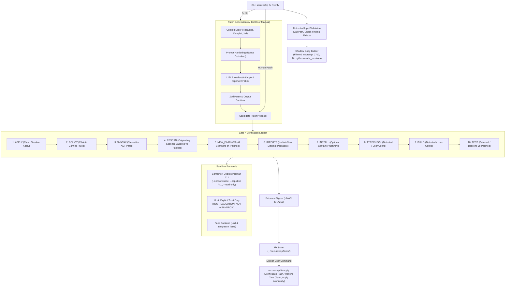

# SecureShip Phase 5: Verified Remediation (Gate 4) — Implementation Plan

## Prerequisite Gate Confirmation

- **Phase 3 Verification Status**: Verified **ACCEPTED** in `docs/phase3/PHASE3_VERIFICATION_REPORT.md` (0 fails, 0 spec gaps, all 17 mutations caught, 0 false-unreachables).
- **Phase 4 Verification Status**: Verified **ACCEPTED** in `docs/phase4/PHASE4_VERIFICATION_REPORT.md` (0 fails, all 21 mutations caught, 0 false-suppressions, 100% injection resistance).
- **Monorepo Gate Verification Status**: All 9 gates verified exiting `0` with a clean working tree:
  1. `pnpm install` — exit code `0`
  2. `pnpm build` — exit code `0`
  3. `pnpm typecheck` — exit code `0`
  4. `pnpm lint` — exit code `0`
  5. `pnpm format:check` — exit code `0`
  6. `pnpm test:coverage` — exit code `0` (Lines: 91.44%, Branches: 82.53%, per-file floor >= 70% lines and branches across all tracked source files)
  7. `pnpm verify:wasm` — exit code `0`
  8. `pnpm verify:mutations` — exit code `0` (all 21 Phase 4 mutations verified caught)
  9. `pnpm benchmark:replay` — exit code `0` (Precision: 92.3%, Recall: 92.3%, F1: 92.3%, Suppression Recall: 92.3%)

---

## Goal

Implement **SecureShip Phase 5 ("VERIFIED REMEDIATION (Gate 4)")** to production standard:

1. **Deterministic Single-Finding Remediation**: For one finding at a time, generate a candidate patch (AI BYOK opt-in) or accept a human-written patch (`verify`), apply it strictly inside an isolated shadow copy outside the repo, evaluate it against a 10-stage verification ladder, and generate an HMAC-signed evidence bundle.
2. **Untouchable Working Tree**: The user's working tree is NEVER modified during generation or verification. The working tree changes ONLY when the user explicitly runs `secureship fix apply <id>`.
3. **Honest & Conservative Claims**: Verification claims are narrow: `VERIFIED_STATIC` or `VERIFIED_RUNTIME` strictly state that the listed checks passed—never that code is "secure", "fixed", or that behavior is guaranteed preserved. `INCONCLUSIVE` is a first-class outcome.
4. **Sandboxed & Contained Execution**: Repo code executes strictly inside a container sandbox (`--network none`, `--cap-drop ALL`, `--security-opt no-new-privileges`, `--read-only`, non-root, strict memory/cpus/pids/tmpfs limits). Host execution requires explicit, per-repo trust confirmed with a typed phrase and is visibly branded `HOST EXECUTION: NOT A SANDBOX`.
5. **Strict Anti-Gaming & Patch Policy Engine**: Diffs are parsed by a zero-dependency strict unified diff parser. Diffs that add suppression markers, delete/edit tests or configs, add net-new dangerous APIs, add unapproved dependencies, hide Trojan Source Unicode, or only delete code are deterministically rejected with distinct violation codes.
6. **Zero New Runtime Dependencies**: Container access via Docker/Podman CLI using `SafeProcessRunner`. Diff parsing, patch application, and policy validation implemented natively with zero external npm runtime dependencies.

---

## User Review Required

> [!IMPORTANT] > **Commercial Tier & Capability Status Text Update**:
> In prior phases, the status and capability text reported:
> `Shadow Worktree Sandbox: Locked (Pro/Team)` and `15 fixes/month`.
> In this Phase 5 build, the shadow copy and sandbox capability is fully implemented as an open BYOK capability. Per user specification, commercial limits are not enforced.
> The status display is updated to:
> `Verified remediation (BYOK): included in this build; commercial tier limits not enforced`

> [!NOTE] > **Docker Environment Status**:
> Docker Desktop (v4.95.0, WSL2 backend) is verified active and running on the host (confirmed via live `docker run hello-world` exit 0). Container tests will execute live with Windows host path translation enabled, and fake backend will remain available for CI fallback.

---

## Architecture & Subsystems



---

## Proposed Changes per Package

### 1. `@secureship/contracts` (Additive contracts; no bump to ScanReport schema)

- [NEW] `packages/contracts/src/remediation.schema.ts`:
  - `PatchProposalSchema` (fingerprint, summary <= 400, diff <= 20000 bytes, rationale <= 600, assumptions <= 5 _ 200, risks <= 5 _ 200, model, promptVersion, attempt).
  - `PatchPolicyViolationCodeSchema`: enum of 23 violation codes (`MALFORMED_DIFF`, `CONTEXT_MISMATCH`, `OUTSIDE_ROOT`, `PROTECTED_PATH`, `TEST_FILE`, `SENSITIVE_FILE`, `BINARY_PATCH`, `SYMLINK`, `MODE_CHANGE`, `NEW_FILE`, `DELETE_FILE`, `RENAME`, `TOO_MANY_FILES`, `TOO_MANY_LINES`, `OUTSIDE_SCOPE`, `SUPPRESSION_MARKER`, `NEW_DEPENDENCY`, `NEW_DANGEROUS_API`, `SECRET_IN_PATCH`, `HIDDEN_UNICODE`, `REMOVAL_ONLY`, `EXCESSIVE_DELETION`, `EOL_INCONSISTENT`).
  - `PatchPolicyResultSchema`: `{ allowed: boolean, violations: Array<{ code, detail, file?, line? }> }`.
  - `StageIdSchema`: enum (`APPLY`, `POLICY`, `SYNTAX`, `RESCAN`, `NEW_FINDINGS`, `IMPORTS`, `INSTALL`, `TYPECHECK`, `BUILD`, `TEST`).
  - `StageOutcomeSchema`: enum (`PASS`, `FAIL`, `SKIPPED`, `INCONCLUSIVE`).
  - `FixReportSchema`: version "1.0", findingRef, patchSha256, baseFiles[{path, sha256}], status (VerificationStatus), stages, sandbox, scanners, attempts, limitations, disclaimer, signature.
  - UserConfig additions for `fix` and `sandbox`.
- [MODIFY] `packages/contracts/src/index.ts`: export new remediation contracts.

### 2. `@secureship/patch-engine` (NEW package; zero runtime dependencies)

- [NEW] `packages/patch-engine/package.json`: workspace package configuration, zero runtime dependencies.
- [NEW] `packages/patch-engine/tsconfig.json`: strict TypeScript compiler configuration.
- [NEW] `packages/patch-engine/src/diff-parser.ts`:
  - Strict unified diff parser verifying headers (`--- a/...`, `+++ b/...`), hunks (`@@ -l,s +l,s @@`), count integrity.
  - Rejects mode lines, binary patches, symlinks, `/dev/null` (new/deleted files), path traversals, UNC/absolute paths.
  - POSIX normalized paths.
- [NEW] `packages/patch-engine/src/applier.ts`:
  - Pure function `(originalText, parsedFile) => patchedText`.
  - Exact context matching at target line with +/-20 lines fallback. Ambiguous matches fail closed (`CONTEXT_MISMATCH`).
  - Preserves CRLF/LF, UTF-8 BOM, and trailing newlines. Rejects mixed line endings (`EOL_INCONSISTENT`).
  - Atomic file writing utility via temp file + atomic rename.
- [NEW] `packages/patch-engine/src/policy-engine.ts`:
  - Enforces all 23 violation rules in strict deterministic order.
  - Anti-gaming suppression markers check.
  - Removal-only and excessive deletion checks.
  - Dangerous API differential counter (added vs removed occurrences of same family).
  - Dependency imports check against Node builtins, Python stdlib static table, and existing project manifest/graph.
  - Trojan Source Unicode and bidi control detection.
  - Secret redaction and optional gitleaks scan.
- [NEW] `packages/patch-engine/src/index.ts`: public exports.

### 3. `@secureship/sandbox` (NEW package; zero runtime dependencies)

- [NEW] `packages/sandbox/package.json`: workspace package configuration, zero runtime dependencies.
- [NEW] `packages/sandbox/tsconfig.json`: strict TypeScript config.
- [NEW] `packages/sandbox/src/shadow/shadow-copy.ts`:
  - Filtered working tree copy outside repository in `mkdtemp` (0700).
  - Excludes `.git`, `node_modules`, virtualenvs, build output, sensitive denylist files (`.env*`, keys, etc.), symlinks pointing outside root, and files > 5MB.
  - Computes and records baseline SHA-256 for all copied files.
  - Proves original tree is unchanged by comparing source SHA-256 manifests before and after.
  - Signal traps and `finally` cleanup to prevent orphan directories.
- [NEW] `packages/sandbox/src/backends/sandbox-backend.interface.ts`: interface for execution backends.
- [NEW] `packages/sandbox/src/backends/container-backend.ts`:
  - Docker and Podman CLI wrapper using `SafeProcessRunner`.
  - Flags: `--rm`, `--network none`, `--cap-drop ALL`, `--security-opt no-new-privileges`, `--pids-limit`, `--memory`, `--memory-swap`, `--cpus`, `--user 1000:1000`, `--read-only`, `--tmpfs /tmp:rw`, `--workdir /work`, bind mount of only shadow copy at `/work`, `--pull=never`.
  - Windows host path translation.
  - Timeouts enforced by runner and `docker kill`; label-based cleanup (`docker rm -f`).
- [NEW] `packages/sandbox/src/backends/host-backend.ts`:
  - Strictly requires `sandbox.backend=host` and repo realpath hash in `trustedHostRepos`.
  - Requires user to type an interactive confirmation phrase before trusting repo:
    `"I trust repository <path> to run un-sandboxed code on my machine"`
  - Explicit warning banner: `HOST EXECUTION: NOT A SANDBOX`.
- [NEW] `packages/sandbox/src/backends/fake-backend.ts`: mock container runner for testing.
- [NEW] `packages/sandbox/src/detector/command-detector.ts`:
  - Detects `typecheck`, `build`, `test` scripts from `package.json` or Python `compileall` / `pytest`.
  - Rejects scripts containing `--watch`.
- [NEW] `packages/sandbox/src/runner/baseline-runner.ts`: runs dynamic stages on unpatched copy first, then patched copy.
- [NEW] `packages/sandbox/src/index.ts`: public exports.

### 4. `@secureship/ai` (Extension for Patch Generation)

- [NEW] `packages/ai/src/remediation/fix-prompt-builder.ts`:
  - Formats untrusted code inside nonce delimiters.
  - Requests structured JSON output `{ summary, diff, rationale, assumptions, risks }`.
- [NEW] `packages/ai/src/remediation/fix-generator.ts`:
  - Category eligibility check (SAST and IAC only; rejects SECRET, SCA, and credential CWEs).
  - Schema validation, one repair retry on malformed JSON, then policy engine check.
  - Bounded (<=1KB), redacted, sanitized feedback on retries.
  - Output sanitization (strips ANSI, control chars, bidi overrides).
  - External HMAC-signed cache for proposals.
- [MODIFY] `packages/ai/src/index.ts`: export fix generation components.

### 5. `@secureship/core-engine` (Remediation Ladder & Fix Store)

- [NEW] `packages/core-engine/src/remediation/verification-ladder.ts`:
  - Orchestrates 10 stages: `APPLY`, `POLICY`, `SYNTAX`, `RESCAN`, `NEW_FINDINGS`, `IMPORTS`, `INSTALL`, `TYPECHECK`, `BUILD`, `TEST`.
  - Dynamic stage outcome rule: baseline pass + patched pass => `PASS`; baseline pass + patched fail => rerun once; still fail => `FAIL`; baseline fail => `INCONCLUSIVE`.
  - Status mapping: `--verify none` => `UNVERIFIED`; any fail => `FAILED`; full ladder pass => `VERIFIED_RUNTIME` or `VERIFIED_STATIC`; any static inconclusive => `INCONCLUSIVE`.
- [NEW] `packages/core-engine/src/remediation/fix-store.ts`:
  - Manages storage outside repo in `~/.secureship/fixes/<repoHash>/<fixId>/`.
  - HMAC signing with per-machine secret.
  - Atomic apply with SHA-256 verification of base files and clean git status check.
- [MODIFY] `packages/core-engine/src/index.ts`: export verification ladder and fix store.

### 6. `@secureship/cli` (Commands & Subcommands)

- [NEW] `packages/cli/src/commands/fix.ts`: `secureship fix <fingerprint|index>`, `fix apply`, `fix list`, `fix show`, `fix discard`.
- [NEW] `packages/cli/src/commands/verify.ts`: `secureship verify <patch-file> --finding <fingerprint>`.
- [NEW] `packages/cli/src/commands/sandbox.ts`:
  - `secureship sandbox status|doctor|enable|disable|trust-host|cleanup`
  - `trust-host` requires user to type interactive confirmation phrase:
    `"I trust repository <path> to run un-sandboxed code on my machine"`
- [MODIFY] `packages/cli/src/commands/status.ts`: update commercial limits wording.
- [MODIFY] `packages/cli/src/commands/doctor.ts`: display sandbox readiness line.
- [MODIFY] `packages/cli/src/index.ts`: register `fix`, `verify`, `sandbox` commands.

#### CLI Exit Codes Reference

| Command Area                | Exit Code | Condition / Meaning                                                                                                        |
| :-------------------------- | :-------: | :------------------------------------------------------------------------------------------------------------------------- |
| `secureship fix` / `verify` |  **`0`**  | Requirement met (`VERIFIED_STATIC` or `VERIFIED_RUNTIME` matching `--require`).                                            |
| `secureship fix` / `verify` |  **`1`**  | Patch produced but status below requirement, or status `FAILED` / `INCONCLUSIVE`.                                          |
| `secureship fix` / `verify` |  **`2`**  | Usage error, config error, ineligible category (`SECRET`/`SCA`), stale finding, or policy refusal.                         |
| `secureship fix` / `verify` |  **`3`**  | Infrastructure failure (AI provider failure, required scanner missing, sandbox failure).                                   |
| `secureship fix` / `verify` | **`130`** | Process interrupted (`SIGINT` / AbortSignal).                                                                              |
| `secureship fix apply`      |  **`0`**  | Patch applied cleanly to working tree.                                                                                     |
| `secureship fix apply`      |  **`2`**  | Refusal (HMAC mismatch, dirty working tree, base hash mismatch, policy violation, non-git repo without `--allow-non-git`). |
| `secureship fix apply`      |  **`3`**  | Filesystem / IO failure.                                                                                                   |

---

### 7. `@secureship/benchmark` (Phase 5 Corpus & Safety Suite)

- [NEW] `packages/benchmark/corpus/fix/`:
  - > = 30 real/synthetic remediation cases with independent oracles.
  - > = 30 adversarial proposals (malicious diffs, suppression attempts, traversal, Trojan Unicode, etc.).
- [NEW] `packages/benchmark/src/remediation-evaluator.ts`: metrics evaluator (malicious-accept threshold 0, false-verified threshold 0, policy-violation recall).
- [NEW] `packages/benchmark/test/gate4-corpus.test.ts`: test suite running corpus in replay and fake mode.

---

### 8. Mutation Suite & Documentation

- [MODIFY] `scripts/verify-mutations.mjs`: extend with the 28 non-negotiable Phase 5 mutation faults:
  1. Allow paths outside root
  2. Allow protected paths
  3. Allow test-file edits
  4. Skip suppression-marker check
  5. Skip hidden-Unicode / Trojan Source check
  6. Skip net-new dangerous API check
  7. Skip new-dependency check
  8. Apply with fuzzy context
  9. Treat scanner-missing RESCAN as PASS
  10. Ignore NEW_FINDINGS
  11. Baseline-fail treated as PASS
  12. Patched-fail retried until pass
  13. Report VERIFIED_RUNTIME when dynamic stages were skipped
  14. Enable container network in non-install stages
  15. Add a capability or drop no-new-privileges
  16. Mount docker.sock or host home
  17. Pass ambient host environment into container
  18. Run repo scripts on host without trust
  19. Let repo config set backend, commands, or images
  20. Include .env / sensitive denylist files in shadow copy
  21. Modify the original working tree
  22. `fix apply` skipping HMAC signature verification
  23. `fix apply` skipping base file SHA-256 hash check
  24. `fix apply` skipping clean git tree check
  25. Auto-commit or auto-branch
  26. Non-atomic file write
  27. EOL / BOM not preserved
  28. Leave orphan containers after abort/SIGINT
- [NEW] `docs/phase5/ARCHITECTURE.md` (Mermaid diagrams and specifications).
- [NEW] `docs/phase5/SANDBOX.md` (Threat model, container flags, verified-live vs docs-only, Windows notes).
- [NEW] `docs/phase5/PATCH-POLICY.md` (23 violation codes with positive and negative examples).
- [NEW] `docs/phase5/EVIDENCE.md` (FixReport schema, HMAC signing, offline verification guide).
- [NEW] `docs/phase5/LIMITATIONS.md` (Explicit disclosure of limitations).
- [NEW] `docs/phase5/mutation-log.md` (Mutation test verification output).

---

## Verification Plan

### Automated Test Gates

```powershell
# 1. Monorepo Build and Typecheck
pnpm build
pnpm typecheck

# 2. Code Quality & Format
pnpm lint
pnpm format:check

# 3. Unit and Integration Test Coverage (>=85% lines, >=75% branches, per-file floor >=70%)
pnpm test:coverage

# 4. WASM Integrity
pnpm verify:wasm

# 5. Full Metamorphic Mutation Suite (Phases 3, 4, 5)
pnpm verify:mutations

# 6. Benchmark Replay
pnpm benchmark:replay
```

### Manual Verification

1. Run `node packages/cli/dist/index.js doctor` and inspect sandbox readiness output.
2. Run `node packages/cli/dist/index.js status` and confirm updated wording.
3. Verify human-patch evaluation via `secureship verify` on sample vulnerable code.
4. Verify `secureship fix apply` atomically applies patch, preserves EOL, and rejects altered base files.
