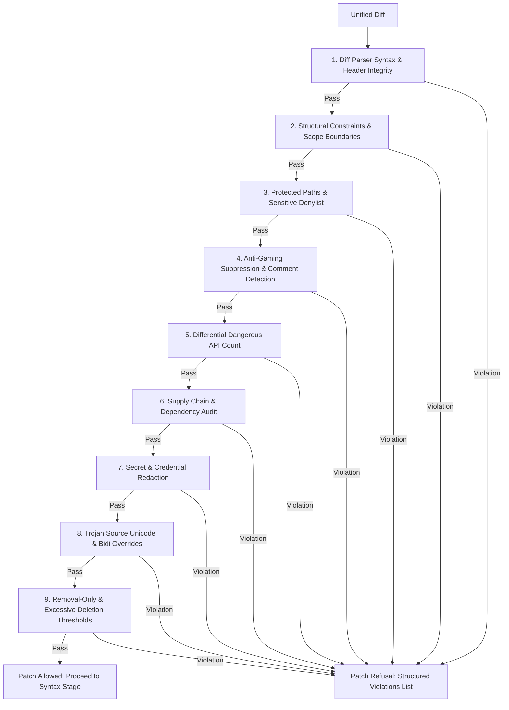

# SecureShip Phase 5: Gate 4 Anti-Gaming Patch Policy Engine

## 1. Overview & Evaluation Order

The Gate 4 **Patch Policy Engine** (`@secureship/patch-engine`) evaluates all proposed patches—whether generated by AI (BYOK) or submitted by human operators (`secureship verify <patch>`)—against 23 strict safety and anti-gaming rules.

Evaluation is deterministic and fails closed: if any violation is detected, `allowed: false` is returned with structured violation records `{ code, detail, file, line }`.



---

## 2. The 23 Violation Codes

### 1. `MALFORMED_DIFF`

- **Definition**: The diff is empty, lacks standard unified diff headers, has invalid hunk counts, or cannot be parsed.
- **Negative Example**:
  ```diff
  Just replace query with parameterized query.
  ```
- **Positive Example**:
  ```diff
  --- a/src/app.ts
  +++ b/src/app.ts
  @@ -10,3 +10,3 @@
   function handle(id: string) {
  -  return db.query("SELECT * FROM users WHERE id = " + id);
  +  return db.query("SELECT * FROM users WHERE id = ?", [id]);
   }
  ```

### 2. `CONTEXT_MISMATCH`

- **Definition**: The context lines in the diff do not match the target file on disk within +/- 20 lines, or match multiple locations ambiguously.
- **Negative Example**: Hunk specifies `oldStart: 10`, but target code was refactored and no matching lines exist within 20 lines.

### 3. `OUTSIDE_ROOT`

- **Definition**: File paths contain directory traversal (`..`), absolute paths (`/etc/passwd`), UNC paths (`//share`), or drive letters (`C:\`).
- **Negative Example**:
  ```diff
  --- a/../../etc/shadow
  +++ b/../../etc/shadow
  ```

### 4. `PROTECTED_PATH`

- **Definition**: Patch modifies protected project infrastructure or build configuration (e.g., `package.json`, `pnpm-lock.yaml`, `.github/`, `.secureship/`).
- **Negative Example**:
  ```diff
  --- a/package.json
  +++ b/package.json
  @@ -5,1 +5,1 @@
  -  "version": "1.0.0"
  +  "version": "1.0.1"
  ```

### 5. `TEST_FILE`

- **Definition**: Patch alters test suites or test fixtures (`*.test.ts`, `tests/`, `spec/`). Automated fixes must never modify their own test assertions to "fix" a bug.
- **Negative Example**:
  ```diff
  --- a/tests/auth.test.ts
  +++ b/tests/auth.test.ts
  @@ -20,1 +20,1 @@
  -  expect(auth(null)).toBe(false);
  +  expect(auth(null)).toBe(true);
  ```

### 6. `SENSITIVE_FILE`

- **Definition**: Patch targets sensitive credential files, private keys, or environment files (`.env*`, `id_rsa`, `*.pem`, `*.key`).

### 7. `BINARY_PATCH`

- **Definition**: Git binary patches or binary files differ indicators.

### 8. `SYMLINK`

- **Definition**: Patch introduces a symlink mode line (`120000`).

### 9. `MODE_CHANGE`

- **Definition**: Patch modifies file executable permissions or mode bits (`old mode 100644`, `new mode 100755`).

### 10. `NEW_FILE`

- **Definition**: Patch creates a net-new file (`--- /dev/null`). Automated single-finding remediation fixes existing files in place.

### 11. `DELETE_FILE`

- **Definition**: Patch deletes an entire file (`+++ /dev/null`).

### 12. `RENAME`

- **Definition**: Patch renames a file (`rename from ...`, `rename to ...`).

### 13. `TOO_MANY_FILES`

- **Definition**: Patch modifies more files than permitted by `fix.maxFiles` (default: 1 file).

### 14. `TOO_MANY_LINES`

- **Definition**: Total changed lines (added + deleted) exceeds `fix.maxChangedLines` (default: 60 lines).

### 15. `OUTSIDE_SCOPE`

- **Definition**: Patch edits lines outside the finding target file or outside the enclosing scope window (+/- 10 lines from finding location).

### 16. `SUPPRESSION_MARKER`

- **Definition**: Patch introduces scanner suppression comments or comments out vulnerable statements to bypass scanners.
- **Target Markers**: `// nosemgrep`, `# nosec`, `# noqa`, `/* eslint-disable */`, `// @ts-ignore`, `// @ts-nocheck`, `# type: ignore`, `// secureship-ignore`, `# checkov:skip`, `// trivy:ignore`, `// gitleaks:allow`.
- **Negative Example**:
  ```diff
  --- a/src/app.ts
  +++ b/src/app.ts
  @@ -12,2 +12,3 @@
  -  eval(userInput);
  +  // nosemgrep
  +  eval(userInput);
  ```

### 17. `NEW_DEPENDENCY`

- **Definition**: Patch imports net-new external third-party packages not already declared in project manifests (`package.json`, `requirements.txt`). Standard library and Node builtins are allowed.
- **Negative Example**:
  ```diff
  --- a/src/app.ts
  +++ b/src/app.ts
  @@ -1,1 +1,2 @@
  +import axios from 'axios';
  ```

### 18. `NEW_DANGEROUS_API`

- **Definition**: Patch increases the net differential count of dangerous function calls (`eval`, `child_process.exec`, `subprocess.Popen`, `pickle.loads`, `yaml.unsafe_load`, or arbitrary network requests).
- **Negative Example**:
  ```diff
  --- a/src/app.ts
  +++ b/src/app.ts
  @@ -10,2 +10,3 @@
  -  safeFormat(str);
  +  child_process.exec(str);
  ```

### 19. `SECRET_IN_PATCH`

- **Definition**: Patch adds lines containing detected plaintext credentials, API keys, or private tokens.

### 20. `HIDDEN_UNICODE`

- **Definition**: Patch introduces Trojan Source bidirectional control characters (e.g., `U+202E`, `U+202A`, `U+200B`) that can visually disguise malicious code.
- **Negative Example**:
  ```diff
  +  return true; \u202E/* admin access */
  ```

### 21. `REMOVAL_ONLY`

- **Definition**: Patch strictly deletes code without adding any replacement logic, effectively disabling functionality rather than fixing security.
- **Negative Example**:
  ```diff
  --- a/src/auth.ts
  +++ b/src/auth.ts
  @@ -15,4 +15,0 @@
  -  if (!isValid(token)) {
  -    throw new Error('Unauthorized');
  -  }
  ```

### 22. `EXCESSIVE_DELETION`

- **Definition**: Patch deletes significantly more lines than it adds (`deleted > max(10, 3 * added)`).

### 23. `EOL_INCONSISTENT`

- **Definition**: Patch contains mixed carriage returns (`\r\n` and `\n`) or embedded `\r` within lines.
