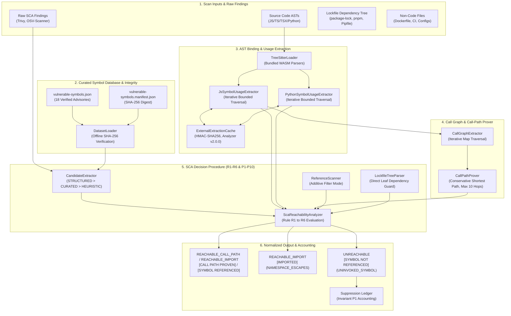
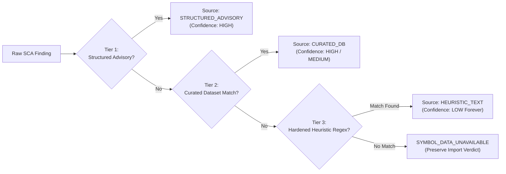
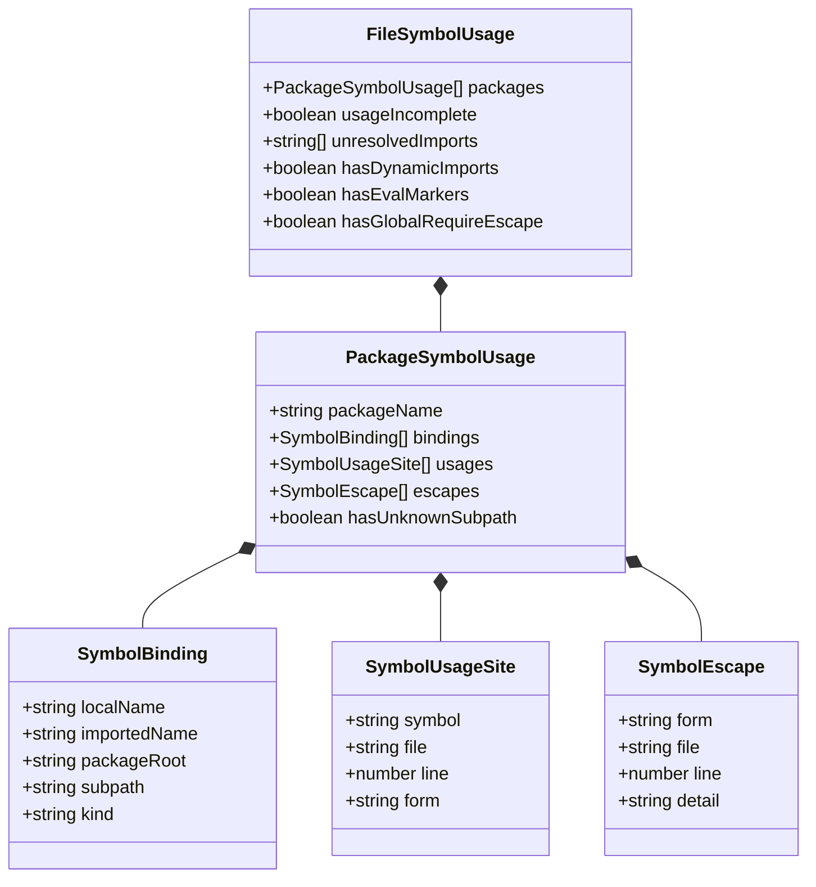

# SecureShip Phase B: Function-Level Reachability — Architecture Specification

**Status:** PRODUCTION STANDARD  
**Version:** 1.0.0 (Phase B)  
**Author:** Principal Security Engineer & Verification Lead  
**Governing Standard:** Anti-Cheat Rules AC1–AC9 & Sound Pruning Principles F1–F10

---

## 1. Architectural Overview & Core Mission

SecureShip Gate 2 previously operated at **package-level reachability**: any direct dependency imported anywhere in a production file was labeled `REACHABLE_IMPORT` (`PACKAGE_IMPORTED`). This caused severe alert fatigue for large utility libraries like `lodash`—an application using only `_.isEqual` or `_.map` was burdened with critical security alerts for uninvoked vulnerabilities such as `lodash.template` command injection (`CVE-2021-23337`).

**Phase B** implements **sound, positive-evidence-based function-level (symbol-level) reachability refinement** for direct dependencies in npm and PyPI ecosystems. Under Phase B:

- Vulnerability findings are pruned from `REACHABLE_IMPORT` to `UNREACHABLE` (`UNINVOKED_SYMBOL`) **only when positive evidence confirms that no vulnerable entry point is referenced or escaped anywhere in production code**.
- Any uncertainty (dynamic imports, non-literal computed property accesses, object escapes, parse ambiguities, transitive dependents, or bin exposure) triggers **fail-closed** behavior, retaining `REACHABLE_IMPORT` or `UNKNOWN`.
- First-party code analysis only: dependency internals (`node_modules`) are not analyzed. If any other installed package depends on the package, function-level pruning is prohibited (precondition P5).
- Zero package-specific heuristics or branches in production code; all curated advisory knowledge is loaded generically and attested with SHA-256 cryptographic manifests.

---

## 2. End-to-End Analysis Pipeline

The following Mermaid diagram illustrates the execution flow through the SecureShip Phase B engine:

---

## 3. Subsystem Architecture

### 3.1. Symbol Data & Candidate Extraction (`CandidateExtractor`)

Candidate symbols are extracted from raw SCA findings through a strictly prioritized three-tier hierarchy:

1. **Tier 1 (`STRUCTURED_ADVISORY`):** Parsed directly from `finding.evidence[].metadata.affected_functions`. (Note: Empirical audit confirmed neither Trivy nor OSV-Scanner currently populates this in the wild; engine is ready when scanners add support).
2. **Tier 2 (`CURATED_DB`):** Matched by ecosystem (`npm` or `pypi`), normalized package name, and advisory identifier/alias intersection (`cveId`, `ghsaId`, `aliases`).
3. **Tier 3 (`HEURISTIC_TEXT`):** Hardened multi-pattern regex matching on advisory titles and descriptions. Implements:
   - English stoplist rejection (`of`, `to`, `in`, `the`, `when`, `node`, `js`, etc.).
   - Identifier length boundary enforcement ($2 \le \text{length} \le 64$).
   - Package name prefix congruence requirement (`<pkg>.<symbol>(` or normalized import alias).
   - Permanent ceiling at `confidence: LOW` (never eligible for Gate 2 suppression).

### 3.2. AST Binding & Usage Extraction (`symbol-usage/`)

Both JavaScript/TypeScript and Python extractors perform **iterative bounded AST traversals** to capture two categories of facts per source file:

#### Binding Forms Handled:

- **JavaScript/TypeScript:** ESM default imports, named imports, renamed imports (`as`), namespace imports (`* as`), CommonJS `require()`, destructuring assignments, CommonJS renamed destructuring, TypeScript `import = require()`, dynamic `import().then()`, and `await import()`.
- **Python:** Standard imports (`import requests`), aliased imports (`import requests as req`), from-imports (`from requests import get`), and aliased from-imports.

#### Escape Forms Handled (Soundness Invariant F1):

Any escape prevents claiming the symbol is unreferenced:

1. Passed as an argument to any function or method (`doSomething(_)`)
2. Returned from a function (`return _`)
3. Exported as default or CommonJS (`export default _`, `module.exports = require('x')`)
4. Stored in object or array literals (`{ lib: _ }`, `[_]`)
5. Object spread expressions (`{ ..._ }`)
6. Object reflection/enumeration (`Object.keys(_)`, `Object.assign`, `Object.entries`)
7. Non-literal computed property access (`_[dynamicKey]`)
8. Reassigned bindings (`let _ = require('x'); _ = alt;`)
9. Python dynamic reflection (`getattr(requests, dyn_var)`)
10. Python wildcard imports (`from requests import *`)
11. Dynamic loader markers (`createRequire`, `module.require`)

### 3.3. Call Graph Hardening & Call-Path Prover (`CallPathProver`)

The call-path subsystem bridges static symbol usage to production entry points:

- **`CallGraphExtractor`:** Hardened from quadratic recursion to an $O(N)$ iterative AST traversal keyed by node ID map. Callee resolution resolves full member access chains (`a.b.c()`), optional chains (`a?.b()`), constructor instantiations (`new A()`), and Python method calls.
- **`CallPathProver`:** Constructs a conservative directed call graph from discovered production entry points. Nodes are resolvable named functions, arrow-function variables, and methods. Edges represent definite resolved call sites.
- **Shortest-Path Traversal:** BFS search finds the shortest chain from an entry point to the vulnerable symbol invocation site (maximum 10 hops, deterministic sorted tie-break).
- **Soundness Invariant F4:** The call graph is **strictly monotonic**—it may only UPGRADE a verdict from `REACHABLE_IMPORT` to `REACHABLE_CALL_PATH`. It is **never** used to downgrade or prune findings, because dynamic dispatch, callbacks, and exports make negative call graph proofs unsound.

### 3.4. Decision Procedure & Precondition Matrix (`ScaReachabilityAnalyzer`)

The core decision procedure evaluates rules **R1 through R6** in strict sequence:

1. **R1 (Candidate Resolution):** Extract candidates. If none found $\to$ preserve import verdict with `SYMBOL_DATA_UNAVAILABLE`.
2. **R2 (Usage Completeness):** Check if any non-test source file failed to parse or hit resource caps $\to$ preserve import verdict with `blockedBy: USAGE_INCOMPLETE`.
3. **R3 (Symbol Referenced / Proved):** If any candidate or its `via` method chain was invoked:
   - Proved call path $\to$ `REACHABLE_CALL_PATH` with `evidenceKind: SYMBOL_CALL_PATH`.
   - Referenced without proven path $\to$ `REACHABLE_IMPORT` with `evidenceKind: SYMBOL_REFERENCED`.
4. **R4 (Namespace Escapes):** If an escape, non-literal computed access, or dynamic require marker is present $\to$ `REACHABLE_IMPORT` with `evidenceKind: NAMESPACE_ESCAPES`.
5. **R5 (Precondition Gate P1–P10):** To prune to `UNREACHABLE` (`UNINVOKED_SYMBOL`), **ALL** ten preconditions must hold:
   - **P1:** Entry points found and resolved.
   - **P2:** Zero parse errors across all non-test source files.
   - **P3:** Zero unresolved local imports, variable dynamic imports, or eval markers.
   - **P4:** Reference scanner clean across config, script, Dockerfile, and unparsed files.
   - **P5:** Lockfile dependency tree present and package is a direct leaf (no installed dependents).
   - **P6:** Package binary exposure safe (no executable CLI wrappers exposed).
   - **P7:** Dataset integrity manifest verified (cryptographic SHA-256 match).
   - **P8:** Dataset entry triggered on `CALL` and `entryPointsComplete: true`.
   - **P9:** Ecosystem rule: npm allowed for `HIGH`; PyPI capped at `MEDIUM`.
   - **P10:** Package not referenced under an alias specifier (`npm:lodash`).
     _If all pass:_ Verdict becomes `UNREACHABLE` (`UNINVOKED_SYMBOL`).
6. **R6 (Transitive & Out-of-Scope Preservation):** Transitive dependencies and unsupported ecosystems retain the exact Phase 3 package-level reachability behavior.

---

## 4. Trust Model & Security Guardrails (F6 & AC1–AC9)

1. **Repo-Resident Trust Guard (Principle F6):**
   Repository-resident configuration files (`secureship.config.json`, `.secureship/config.json`) and repository-resident files (`.secureship/symbols.json`) are **strictly prohibited** from:
   - Supplying custom symbol datasets.
   - Disabling or reconfiguring function-level reachability.
   - Overriding integrity manifests.
     If a repository attempts to supply reachability dataset settings, `ConfigLoader` discards the setting and issues a prominent security warning.
2. **Cryptographic Manifest Attestation:**
   The bundled `vulnerable-symbols.json` is protected by `vulnerable-symbols.manifest.json`. Tampering with any byte causes `DatasetLoader` to fail-closed, disabling function-level pruning and preserving package-level verdicts.
3. **External Authentication Cache:**
   All AST fact extraction is cached in `~/.secureship/cache` (or Windows `%LOCALAPPDATA%`), keyed by HMAC-SHA256 with a machine-local key, entirely outside the target repository. Cache entries carry `ANALYZER_VERSION = '2.0.0'`; any version mismatch triggers full recomputation.
4. **Zero-Network Invariant (Principle F8):**
   SecureShip executes 100% locally. Zero network calls, zero package manager executions, zero telemetry.
