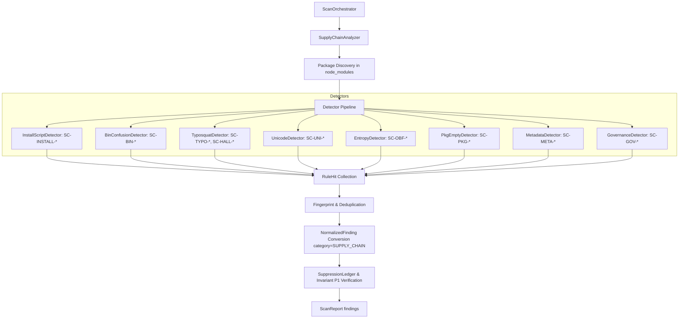

# SecureShip Supply-Chain Threat Engine

The SecureShip Supply-Chain Threat Engine is a deterministic, offline-capable analysis pipeline that inspects third-party npm and PyPI dependencies for zero-day malware, install script abuses, Unicode trojans, obfuscated payloads, typosquats, and governance anomalies.

---

## Architecture Overview



---

## Phased Implementation Roadmap

- **Phase 1 (WP0–WP3)**:
  - WP0: Reconnaissance & documentation skeleton
  - WP1: Core schemas, policies, and contracts
  - WP2: Pure, offline detectors (scripts, bins, typosquats, unicode, entropy, empty packages, metadata, governance)
  - WP3: Supply-chain analyzer orchestration, metadata providers (`NullProvider`, `SnapshotProvider`)
- **Phase 2 (WP4–WP9)**:
  - WP4: AST capability queries via Tree-sitter (`SC-CAP-*`)
  - WP5: Full first-class normalized finding schema extension
  - WP6: Gate 3 AI supply-chain triage slicer
  - WP7: Gate 4 pre-install gate & sandbox isolation
  - WP8: CLI commands, policy controls, SARIF export extensions
  - WP9: Hardening, fuzzing, and comprehensive benchmark corpora

---

## Running Supply-Chain Analysis

Supply-chain scanning is configured via `secureship.config.json` or programmatically via `ScanOrchestrator`:

```json
{
  "supplyChain": {
    "enabled": true,
    "provider": "null",
    "concurrency": 8,
    "failOnSeverity": "HIGH"
  }
}
```
