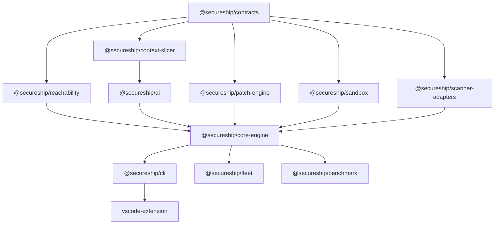

# SecureShip-IDE Production-Readiness Audit

# 02. Inventory and Architecture

**Audit Date:** October 27, 2026  
**Subject Commit:** `70c3087b863d06538a6b7116eaa4d22e25073e29`  
**Monorepo Version:** `0.1.0`  
**Auditor:** Autonomous Verification Engine

---

## 1. Monorepo Package Topology & Dependency Graph

SecureShip-IDE is organized as a pnpm monorepo containing 13 distinct workspace packages. The dependency graph flows from foundational contracts and parsers upward to orchestration and client interfaces.



---

## 2. Package Inventory Details

| Package Name                                                                              |   Version    | Private? | Primary Purpose                                                         | Key Dependencies                                      |
| :---------------------------------------------------------------------------------------- | :----------: | :------: | :---------------------------------------------------------------------- | :---------------------------------------------------- |
| [`@secureship/contracts`](file:///c:/dev/SecureShip-IDE/packages/contracts)               |    0.1.0     |   Yes    | Zod finding schemas, license contracts, brand mapping                   | `zod`                                                 |
| [`@secureship/reachability`](file:///c:/dev/SecureShip-IDE/packages/reachability)         |    0.1.0     |   Yes    | WebAssembly Tree-sitter import graph & symbol reachability              | `web-tree-sitter`, `@secureship/contracts`            |
| [`@secureship/context-slicer`](file:///c:/dev/SecureShip-IDE/packages/context-slicer)     |    0.1.0     |   Yes    | Context window extraction, secret redaction, AST slicing                | `@secureship/contracts`, `@secureship/reachability`   |
| [`@secureship/ai`](file:///c:/dev/SecureShip-IDE/packages/ai)                             |    0.1.0     |   Yes    | AI Gate 3 skeptical triage, prompt isolation, budget caps               | `@secureship/context-slicer`, `@secureship/contracts` |
| [`@secureship/patch-engine`](file:///c:/dev/SecureShip-IDE/packages/patch-engine)         |    0.1.0     |   Yes    | Unified diff parser, patch safety policies, Trojan source defense       | `@secureship/contracts`                               |
| [`@secureship/sandbox`](file:///c:/dev/SecureShip-IDE/packages/sandbox)                   |    0.1.0     |   Yes    | Isolated container & host execution runners, shadow copy engine         | `@secureship/contracts`                               |
| [`@secureship/scanner-adapters`](file:///c:/dev/SecureShip-IDE/packages/scanner-adapters) |    0.1.0     |   Yes    | Safe process runners for Opengrep, Gitleaks, Trivy, Checkov             | `@secureship/contracts`                               |
| [`@secureship/core-engine`](file:///c:/dev/SecureShip-IDE/packages/core-engine)           |    0.1.0     |   Yes    | Core scan orchestrator, Gate 1-3 suppression ledger, remediation ladder | All core packages                                     |
| [`@secureship/fleet`](file:///c:/dev/SecureShip-IDE/packages/fleet)                       |    0.1.0     |   Yes    | Centralized enterprise aggregation server, JSON file storage, CRA/SBOM  | `@secureship/core-engine`, `@secureship/contracts`    |
| [`@secureship/license-server`](file:///c:/dev/SecureShip-IDE/packages/license-server)     |    0.1.0     |   Yes    | Cloudflare Workers license activation, validation & Stripe webhook      | `itty-router`, WebCrypto                              |
| [`@secureship/cli`](file:///c:/dev/SecureShip-IDE/packages/cli)                           | 1.0.0-beta.1 |  **No**  | Terminal interface, tsup bundler, command dispatchers                   | All monorepo packages (bundled)                       |
| [`@secureship/benchmark`](file:///c:/dev/SecureShip-IDE/packages/benchmark)               |    0.1.0     |   Yes    | Ground-truth benchmark evaluation harness & synthetic corpora           | `@secureship/core-engine`                             |
| [`secureship-security`](file:///c:/dev/SecureShip-IDE/packages/vscode-extension)          |    0.1.0     |   Yes    | VSCode extension with tree view, code actions, background runner        | External VSCode API                                   |

---

## 3. Four-Tier Gate Architecture & Data Flow

SecureShip implements a phased, zero-false-positive filtering architecture:

```
           +-------------------------------------------------------+
           |                Raw Findings Ingestion                 |
           |   (Opengrep, Gitleaks, Trivy, Checkov, OSV-Scanner)   |
           +---------------------------+---------------------------+
                                       |
                                       v
           +-------------------------------------------------------+
           |               GATE 1: Scope Classifier                |
           |      (Production vs Test, Mock, Benchmark, Docs)      |
           +---------------------------+---------------------------+
                                       |
                                       v
           +-------------------------------------------------------+
           |           GATE 2: AST Reachability Engine             |
           | (Tree-sitter WASM Graph Traversal & Uninvoked Symbols)|
           +---------------------------+---------------------------+
                                       |
                                       v
           +-------------------------------------------------------+
           |            GATE 3: AI Skeptical Reviewer              |
           |   (Isolated Prompt Nonces, Citation Quote Proving)    |
           +---------------------------+---------------------------+
                                       |
                                       v
           +-------------------------------------------------------+
           |               REMEDIATION & VERIFICATION              |
           |    (Shadow Copy, Patch Policy, Clean Baseline Run)    |
           +-------------------------------------------------------+
```

1. **Gate 1 (Scope Classifier):** Classifies file paths into `PRODUCTION`, `TEST_OR_MOCK`, `EXAMPLE`, or `BENCHMARK`. Filters findings occurring in non-production code paths.
2. **Gate 2 (AST Reachability):** Employs offline Tree-sitter WebAssembly parsers (JavaScript, TypeScript, Python, Go, Rust, Java, C#) to construct precise import graphs and identify dead paths or uninvoked vulnerable symbols.
3. **Gate 3 (AI Skeptic Reviewer):** Operates on sanitized AST context slices. Enforces strict cryptographic nonces, strips Trojan Source bidi characters, verifies exact quote citations against source code, and requires multi-sample self-consistency.
4. **Remediation Ladder:** Validates proposed code fixes against clean baseline test suites in an isolated sandbox before allowing patches to be merged.

---

## 4. External Network Egress Points

Under default configuration, SecureShip functions entirely air-gapped without requiring network connectivity. Network egress is strictly isolated to opt-in features:

1. **AI Provider Egress (`packages/ai`):**
   - Target Host: `api.anthropic.com`, `api.openai.com`, or custom enterprise base URL.
   - Guardrails: Nonce protection, strict HTTPS for non-loopback, 1 MB response cap, `redirect: 'error'`, max concurrency 2.
2. **License Activation Egress (`packages/cli` & `packages/license-server`):**
   - Target Host: `https://license.secureship.io/v1/activate`, `/v1/validate`.
   - Guardrails: RSA-2048 / WebCrypto signature verification.
3. **Fleet Aggregator Egress (`packages/fleet`):**
   - Target Host: Configurable corporate fleet endpoint (`http://localhost:8080` or corporate intranet).
   - Payload: Anonymized scan summary, findings metadata, SBOM component list.
